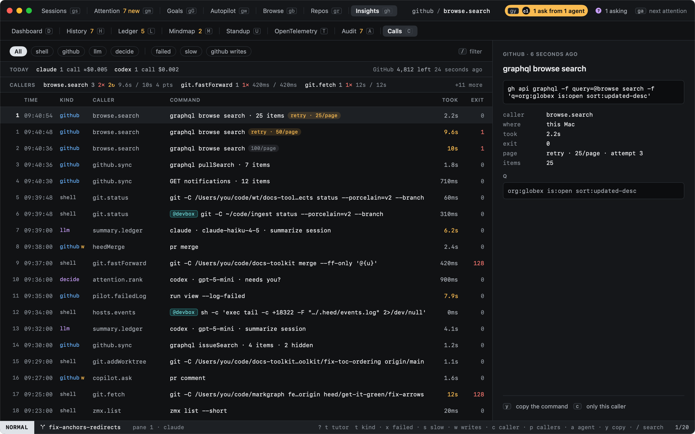

# Reference

The pages here list facts: commands, files, variables and terms. Look here when you know what you want to find. The
[key reference](../keyboard/reference.md) and the [`config.toml` reference](../configuration/reference.md) sit with their
sections, because heed generates both from the code.

- [The heed CLI](cli.md): the commands the helper agents' hooks call, the control socket, and `heed goal`, `heed swarm`
  and `heed memory`, with their exit codes.
- [Files and locations](files.md): config, cache, the databases, the socket and hook files, and what heed writes on a host.
- [Call log](call-log.md): every command heed ran and every GitHub call it made. `:log` opens it, and the screenshot above shows it.
- [Environment variables](environment.md): what heed sets in panes, and what heed reads.
- [Glossary](glossary.md): every term the docs use, in one or two lines, with a link to its page.

## Which page answers what

| You want to know | Page |
|---|---|
| Which key does X | [Keys](../keyboard/reference.md) |
| Which setting changes X | [`config.toml`](../configuration/reference.md) |
| What heed ran, and what GitHub said | [Call log](call-log.md) |
| Where heed keeps its data | [Files and locations](files.md) |
| What a word in the docs means | [Glossary](glossary.md) |
