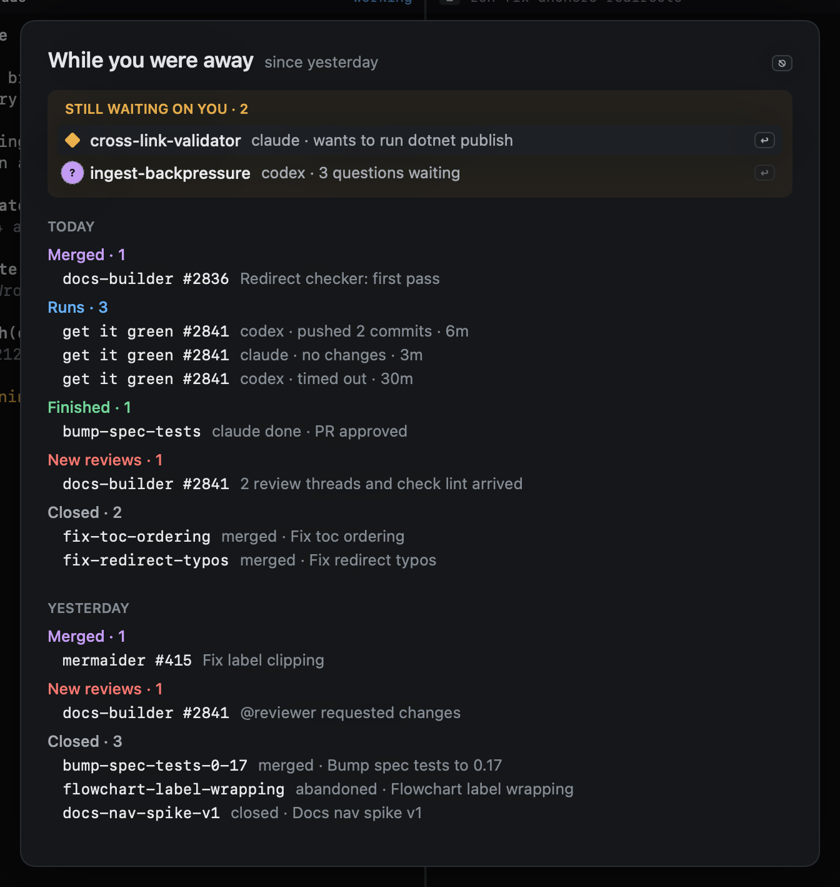

# While you were away

Come back to Heed after a night or a weekend and it shows what happened in the meantime, so you do not have to walk
every view to find out.



On top, pinned, **Still waiting on you**: the sessions in Needs you right now (asking, blocked or rate limited), each
with what its agent wants. `j` and `k` move between them, and `↩` closes the summary on that session.

Below it, each day, newest first (Today, Yesterday, then the weekday and date), grouped by kind:

| Kind | What it lists |
|---|---|
| Merged | Pull requests that merged, by their title |
| Runs | [Get it green and get it merged](../github/watch.md) runs that ended: the agent, how it ended (pushed commits, no changes, timed out, failed) and how long it took |
| Finished | Sessions whose agent finished its turn and is done |
| New reviews | Reviews on your pull requests (approved, changes requested, commented) and review threads that arrived |
| Closed | Sessions that were closed, with how they ended |

`⎋` closes it.

## When it opens

On its own, when Heed has not been the app in front for `away_hours` (8 by default): when you come back to it, when
the Mac wakes with Heed in front, or when Heed starts after that long. It opens only when there is something to show,
after the [resume dialog](resume.md) if that is up, and it never takes focus: it waits in the window until you look.

Any time, `gZ` (or `:summary`, or **While you were away…** in the menu bar owl's menu and the Window menu) opens it for
today and yesterday, or further back when the last one that opened on its own went back further.

```toml
[summary]
away_hours = 8      # 0: never on its own; gZ still opens it
```

## What it knows

The summary is drawn from what Heed already keeps: the pilot's log (kept for at least two weeks), the runs, the pull
requests' reviews, your sessions and their history. Merges are seen for pull requests Heed fetches details for (the
ones your sessions track), and a session counts as finished while its agent is still done: one you have typed in again
since moves on.
