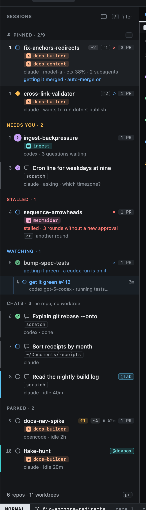
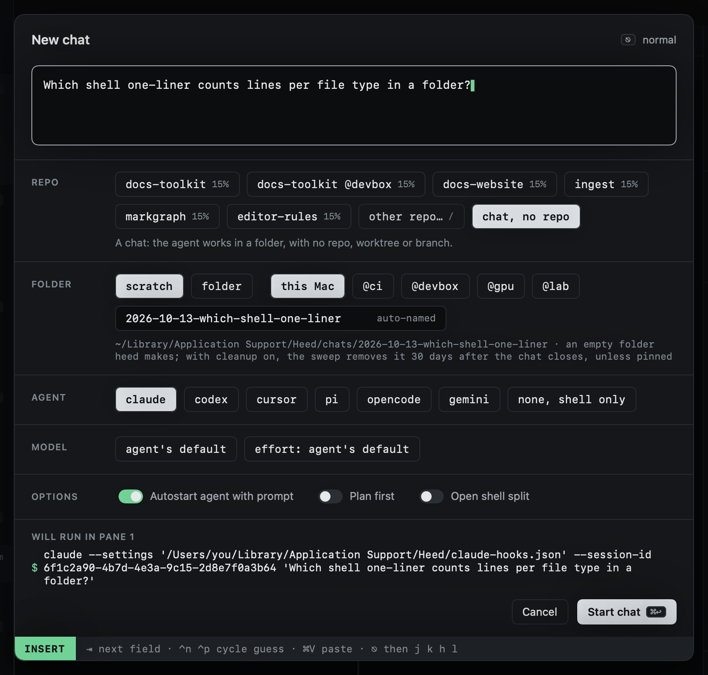
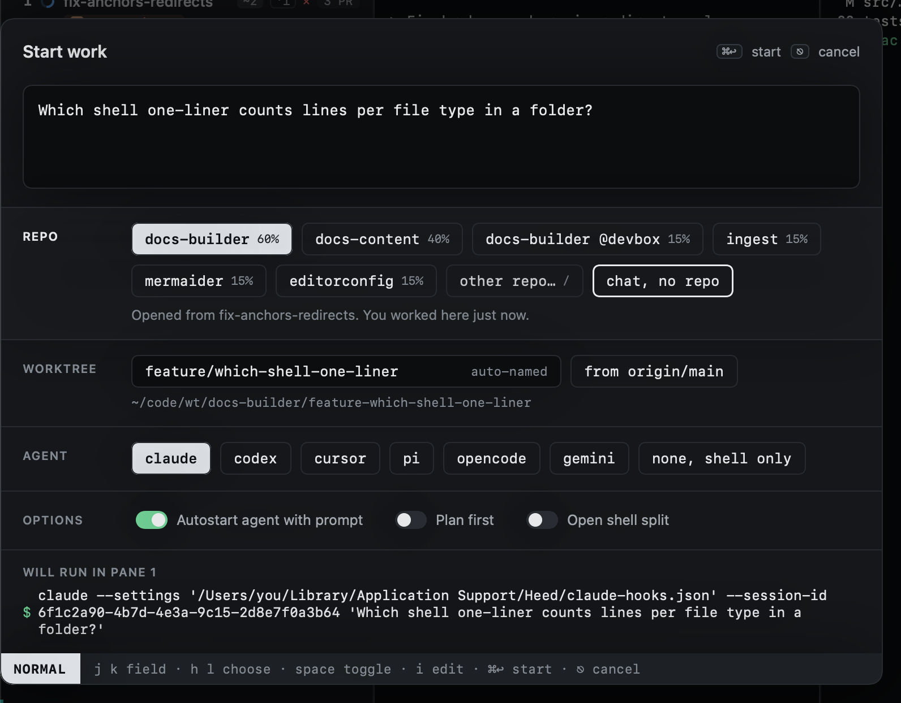
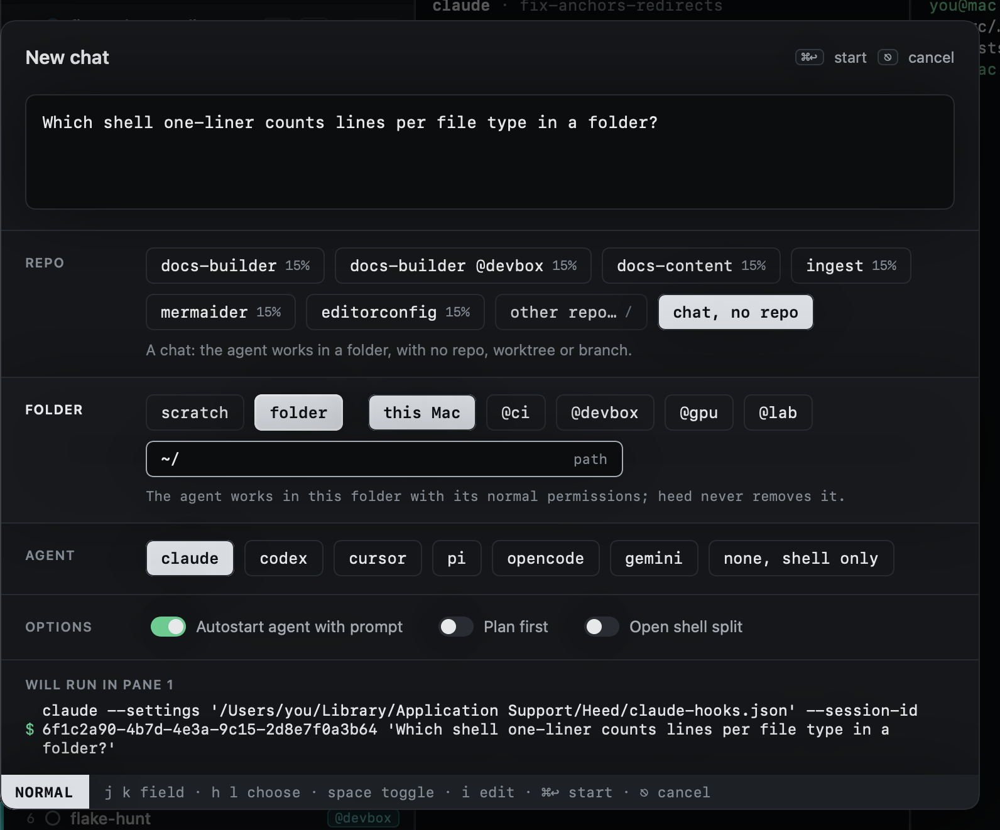
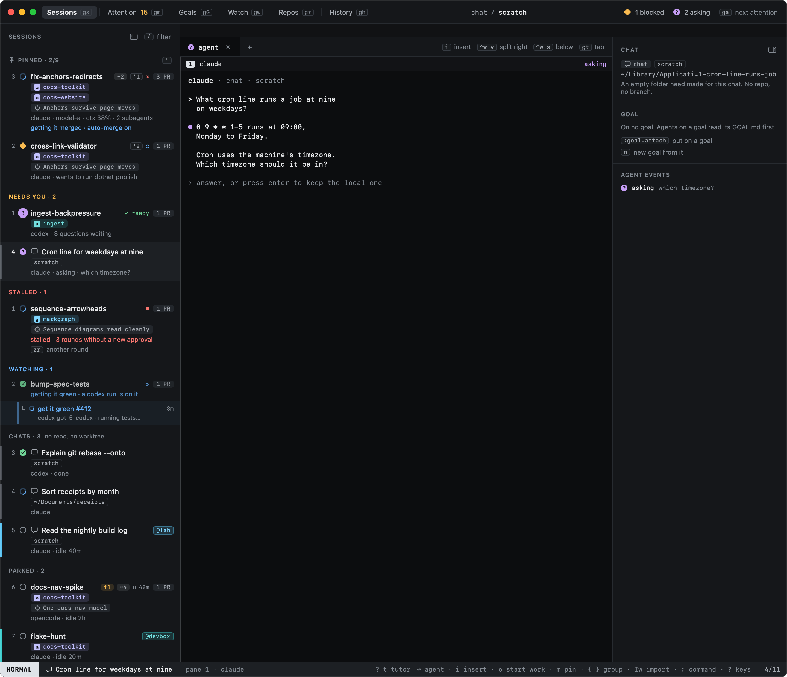
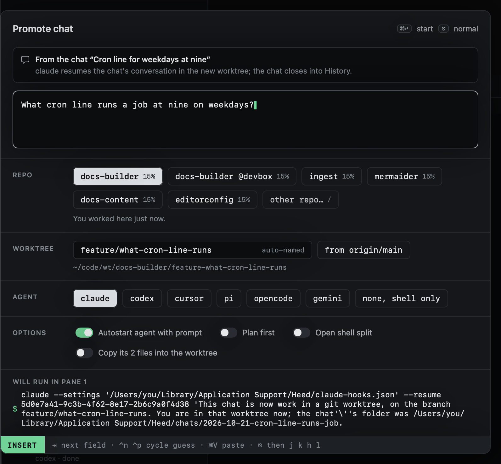
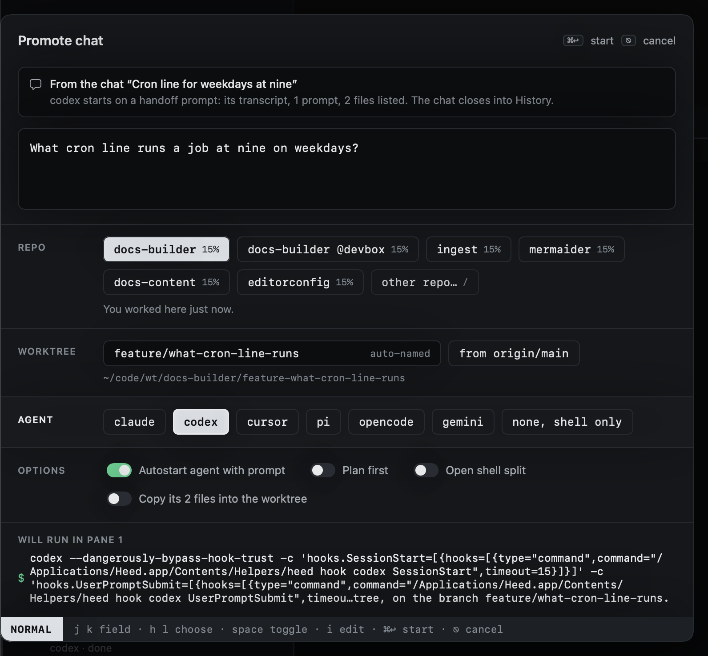
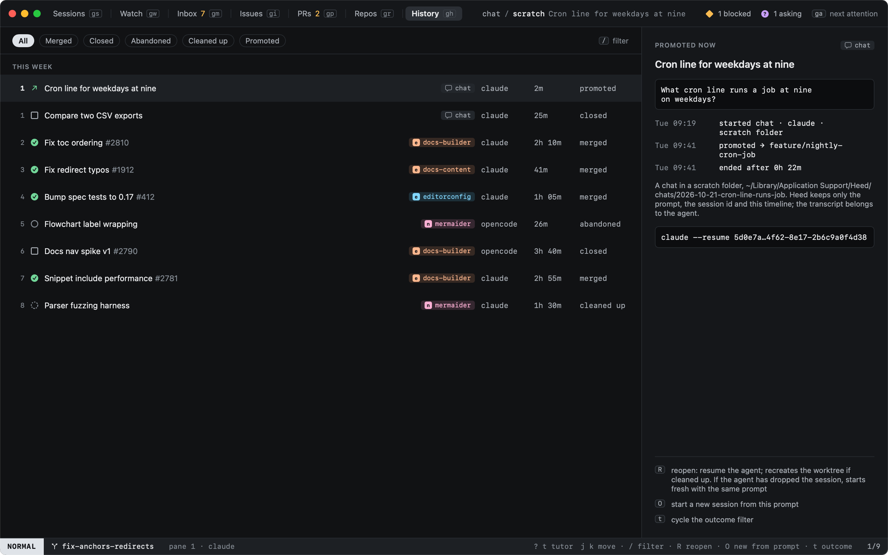
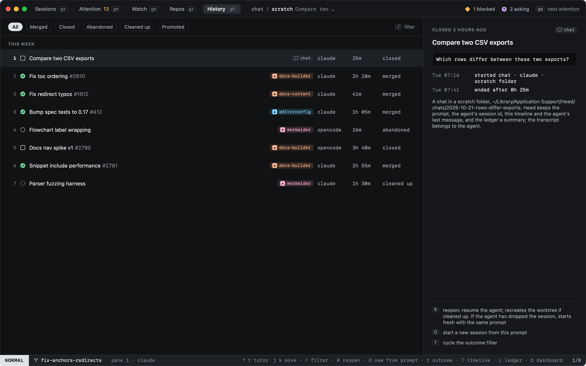

# Chats

Sometimes you just want to ask an agent something, with no repo, worktree or branch. A chat is a session that runs in
a folder instead of a worktree. It is listed in its own **Chats** group in the sidebar, with a speech bubble where a
session in a repo shows its repos.

A chat that is asking or blocked moves to **Needs you** like any other session, so Needs you is still the one place to
look for what waits on you. A pinned chat is under Pinned, a parked one under Parked.

## Starting one

`:chat`, or `:chat` followed by what you want to ask, opens the Start work dialog as **New chat**. The full command is
`chat.new`; it has no key of its own, and you can bind one (see [Customizing keys](../keyboard/customizing.md)).

From Start work itself (`o`), the last chip in the Repo field is **chat, no repo**. Pick it and the dialog becomes a
chat. Picking a repo chip turns it back into work in that repo.

The Folder field, where Start work has the Worktree field, says where the agent works:

- **scratch** (the default): an empty folder Heed makes for this chat, named after the day and your prompt, under
  `~/Library/Application Support/Heed/chats` on this Mac or `~/.heed/chats` on a host. `i` edits its name.
- **folder**: a folder you pick. `i` types its path. The agent works there with its normal permissions, and Heed never
  removes it.

The same field picks where the chat runs: **this Mac** or one of your [hosts](../hosts/index.md). The agent and
options are the same as for Start work. A chat has no setup step, tasks or worktree files, because it has no repo.

The first time you start a scratch chat with Claude Code, Heed marks the chats folder as trusted in `~/.claude.json`, so
Claude does not ask about each new scratch folder. Heed made the folder, so this is not a surprise. `[worktrees]
offer_trust = false` turns this off. A folder you pick is yours to trust.

## In a chat

A chat works like any session: panes and tabs, typing into the agent, [handoff](handoff.md),
[resume](resume.md), pin, park and close. What needs a repo is not there. A chat has no diff, pull requests, pilot
or "Open repo", and its right-click menu leaves them out. `O` (and **New chat from its prompt** in its menu) opens New
chat with the same prompt.

The inspector shows the chat's folder where a session shows its worktree.

## Turning a chat into work

When a chat turns into something worth a branch, `:promote` (the full command is `chat.promote`, also **Promote to
work…** in the chat's right-click menu) opens Start work as **Promote chat**. The chat's first prompt is the task. Pick
the repo and the agent as for any Start work: by default the agent is the chat's own, and it can be another.

Heed makes the worktree and the session as Start work does, then hands over the conversation:

- **claude into claude**: the new session resumes the chat's own Claude Code session (`claude --resume <id>`), which
  Claude finds from any folder. It is told that it is now in a worktree on a new branch, where the chat's folder was,
  and what the task is.
- **Any other agent**, or a claude chat whose transcript is gone: the agent starts on a handoff prompt with the task,
  the path to the chat's transcript (for claude chats), what was asked in the chat, the files in the chat's folder, and
  the repo's `start_instructions`.

The files in a scratch chat's folder are listed in the handoff and stay where they are. The option **Copy its files
into the worktree** copies them, leaving any file the worktree already has. A folder you picked is listed, never
copied.

The chat then closes into History as **promoted**, its timeline naming the branch it became.

A chat on a host hands over only its prompt: its transcript and files are on the host.

## In History

A closed chat goes to History, marked **chat** where other sessions show their repo. `R` reopens it in its folder. If
its scratch folder is gone, Heed makes it again, empty. If a folder you picked is gone, Heed says so and does not
make it.

