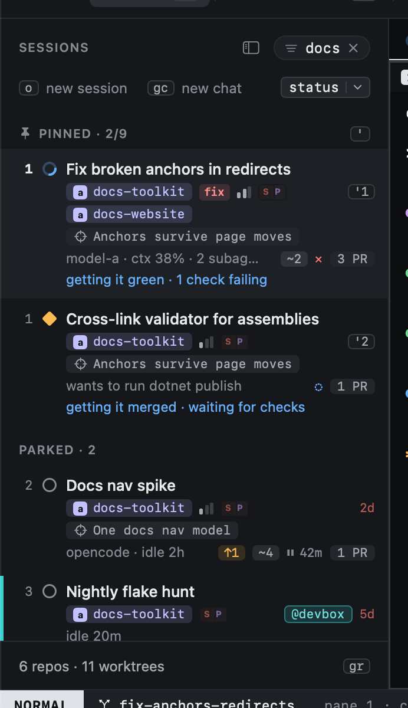

# Filtering

`/` filters the list you are on. You type in the status bar, and the sidebar shows the filter as a pill and narrows the
list as you type.

## What a word matches

In Sessions, every word you type must appear somewhere in the session. heed looks in the session's title, worktree
name, branch, agent, repo names, host and tracked PR numbers, written `#2841`. Case does not matter, and a word matches
inside longer words. `docs fix` finds a docs-toolkit session on a fix branch.

The words can match different fields: `docs` can match the repo and `fix` the branch.

## Keeping the filter

Press `↩` to stop typing and keep the filter. The pill stays in the sidebar, and `j` and `k` move through the matches.

| Key | |
|---|---|
| `↩` | Keep the filter and stop typing |
| `⎋` | Clear the filter and stop typing |
| `⌫` | Delete a character. On an empty filter, `⌫` stops typing |
| `⌃w` | Drop the last word |
| `⌃u` | Clear what is typed |
| `⌘V` | Paste at the cursor, on one line |

A click on the pill's ✕ clears the filter. The cursor goes back to the first match each time the filter changes.

## Other lists

Every list view filters the same way, and each view keeps its own filter. Which fields a word matches depends on the
view:

| View | A word matches |
|---|---|
| PRs | The title, the repo, the number and the branch |
| [Repos](../worktrees/index.md) | The repo, the branch, the path below its root, the agent and the host |
| [History](../insights/history.md) | The title, the prompt, the branch, the agent, the repo names and the host |

Attention, Autopilot, the call log and the other lists match the words their rows show.
