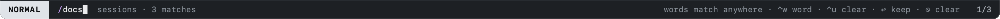
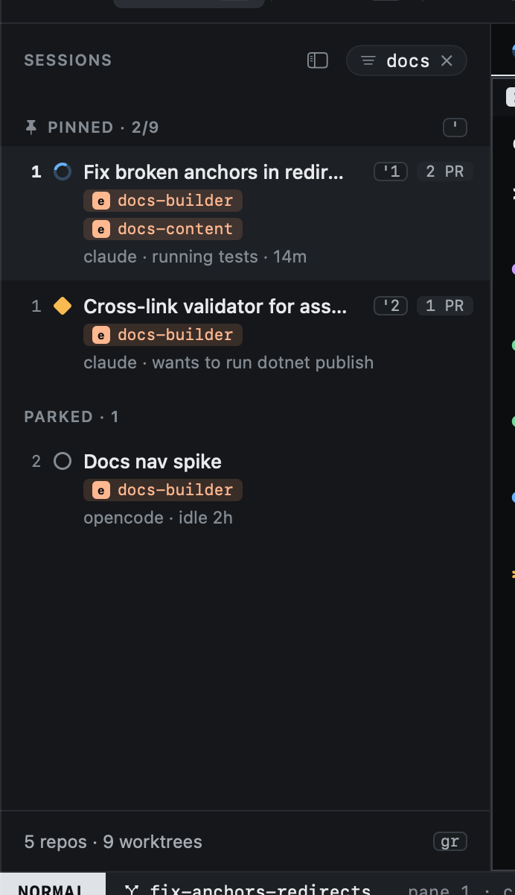

# Filtering

`/` filters the sessions list. You type in the status bar; the sidebar shows the filter as a pill and narrows as you
type.

Every word you type must appear somewhere in the session: its title, branch, agent, repos or pull request numbers.
`docs fix` finds a docs-builder session on a fix branch.

| Key | |
|---|---|
| `↩` | Keep the filter and stop typing |
| `⎋` | Clear it |
| `⌃w` | Drop the last word |
| `⌃u` | Clear what is typed |

Clicking the pill's ✕ clears it too. Every list view filters the same way, each keeping its own filter.
