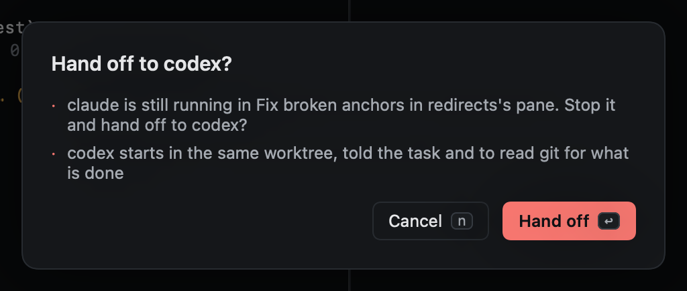

# Handing a session to another agent

When the agent in a session can't go on (it hit its usage limit, or it is going in circles), hand the session to
another agent: `gA`, or `:agent.switch codex`. `gA` opens the command line on `agent.switch ` and lists the agents
configured in Settings, except the session's own; `⇥` picks one. After the agent and a space it lists that agent's
models, and after a model its reasoning efforts: `:agent.switch codex gpt-6-luna high`, or `-` for the agent's default
model (`:agent.switch claude - max`). Left out, the agent starts on its own [model and effort](../agents/models.md).
Right-click a session row, or its agent's tab, for **Hand off to…** with the same list.

If the session's agent is still running, Heed asks first, because handing off stops it. Once its agent has exited, the
handoff happens right away.

What happens:

- The agent pane is replaced by a new one in the same place, in the session's worktree, on this Mac or on its host.
  The old pane's terminal ends, and with [zmx](zmx.md) its zmx session too, so the old agent is not left running.
- The new agent starts the way Start work starts one, with Heed's hooks, so its state is reported from the first
  turn.
- It starts on a short handoff prompt: the branch it takes over and from which agent, the session's original task,
  to check `git status`, `git log` against the base branch and the diff to see what is done, the session's open pull
  requests, and the repo's `start_instructions` if it has any.
- The session now shows the new agent. Its usage, subagents and agent session id start fresh, and its history says
  "handed off from claude to codex".

Use this rather than quitting the agent and starting another one yourself. Claude and Codex get their hooks from
Heed's launch flags, so one you start by hand in the pane isn't reported (see [Hooks](../agents/hooks.md)).
