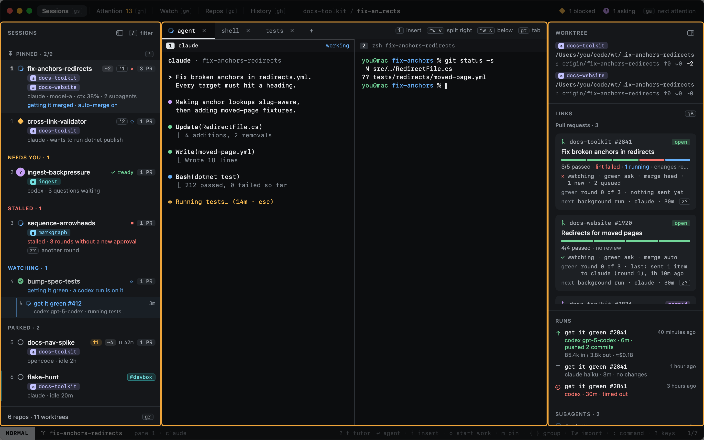

# Sessions

The Sessions view is where Heed opens (`gs` from anywhere). It has four parts.

1. **The sidebar**: every session, grouped by what it needs from you. See [The sidebar](sidebar.md).
2. **The center**: the selected session's tabs and panes, real terminals running the agent and anything else.
   See [Panes and tabs](panes-and-tabs.md).
3. **The inspector**: the session's worktrees, pull requests and agent events. See [The inspector](inspector.md).
4. **The status bar**: the mode, the branch and pane, and the keys that matter right now.

Across the top, the title bar names the views with their keys, shows what you are looking at in the middle, and counts
the sessions waiting on you on the right.

## In this section

- [The sidebar](sidebar.md) · [Moving around](moving-around.md) · [Typing into agents](typing-into-agents.md)
- [Panes and tabs](panes-and-tabs.md) · [The inspector](inspector.md)
- [Pin, park, close, delete](pin-park-close-delete.md) · [Resuming sessions](resume.md) · [Handing off](handoff.md) · [Agents that outlive Heed](zmx.md) · [Filtering](filtering.md)
