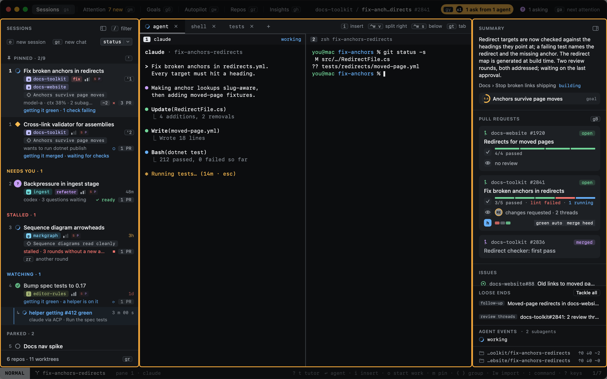
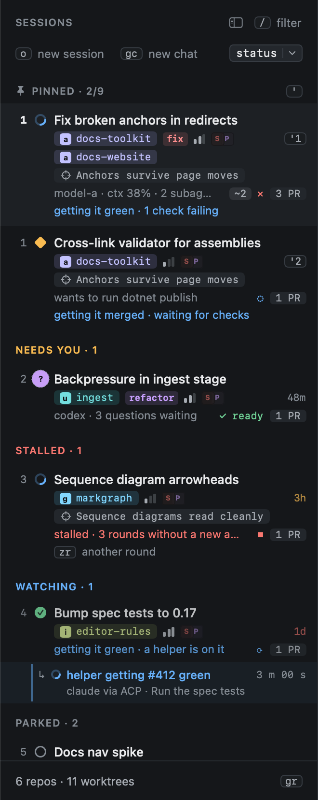
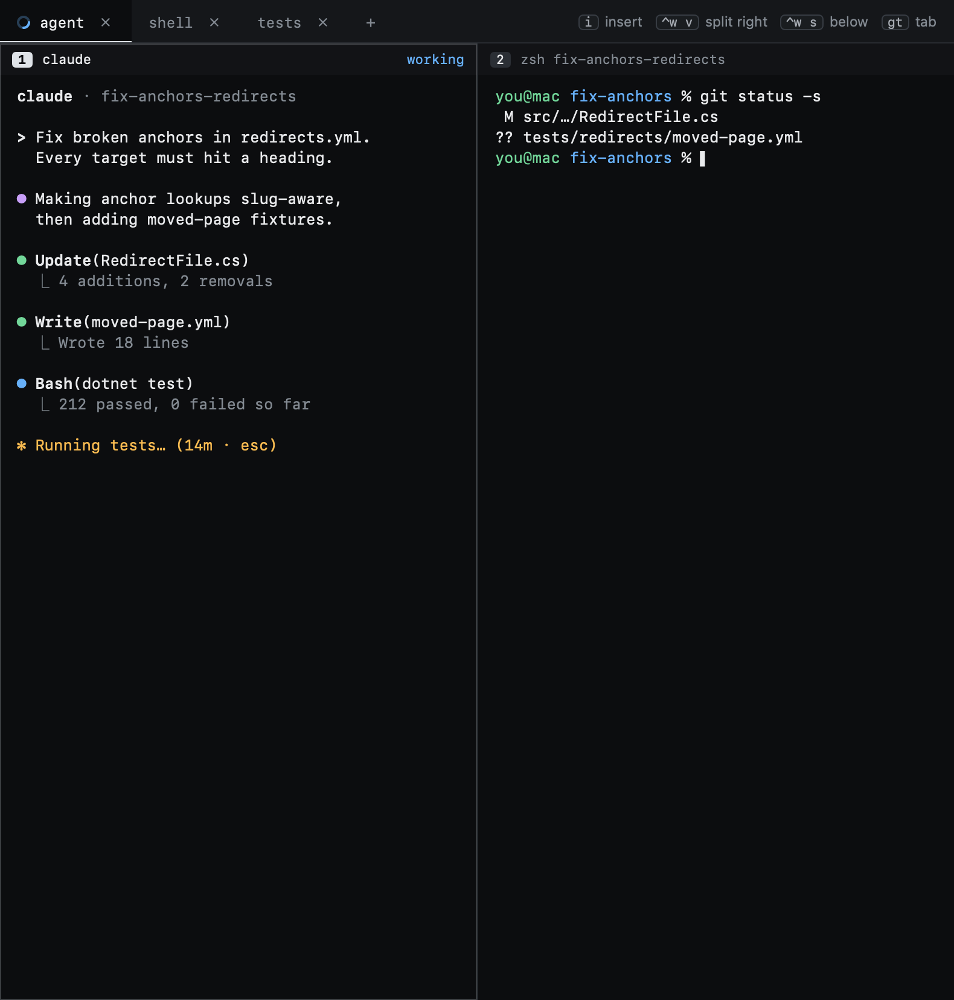
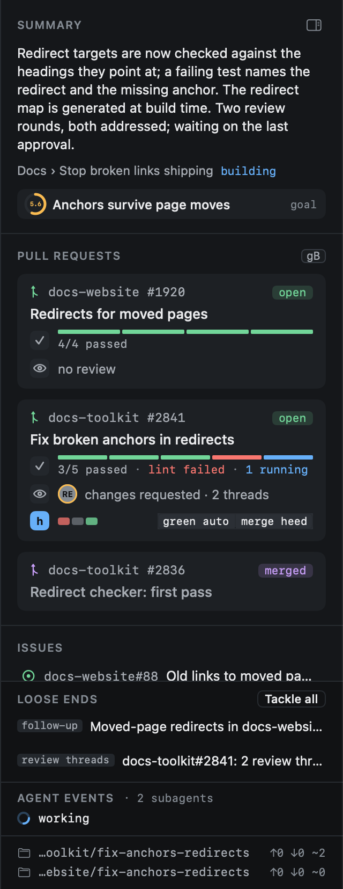
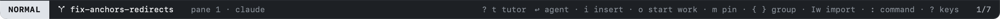
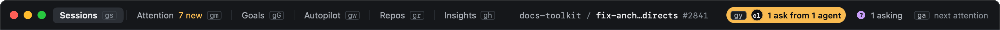

# Sessions

Every agent you run is a session, and the Sessions view shows all of them at once. heed opens on this view. `gs`
returns to it from anywhere. The view has four parts, and the title bar runs across the top.

1. **The sidebar**: every session, grouped by what it needs from you. See [The sidebar](sidebar.md). `zs` hides it.
2. **The center**: the selected session's tabs and panes, real terminals running the agent and anything else.
   See [Panes and tabs](panes-and-tabs.md).
3. **The inspector**: the session's worktrees, PRs and agent events. See [The inspector](inspector.md). `zi` hides it, and it also gives way on windows narrower than 1180 points.
4. **The status bar**: the mode, the branch and pane, and the keys that matter right now.

The sidebar lists every open session. Pinned sessions come first, then the sessions that need you, the stalled ones and
the ones heed is watching.

The center shows the selected session. Its agent runs in a real terminal pane, and a shell can sit beside it.

The inspector explains the session around the agent: what it is about, which PRs it opened and how they stand, and
which worktrees it holds.

The status bar names the mode on the left, then the session's branch and pane. On the right, it shows the keys that work
in the view you are on, and the cursor's position in the list.

Across the top, the title bar names the views with their keys. In the middle, it shows the session or item you are
looking at. On the right, it counts the sessions waiting on you.

## In this section

- [The sidebar](sidebar.md): every session, grouped by what it needs from you.
- [Moving around](moving-around.md): `j` and `k`, counts, pins and the jump to the next session that needs you.
- [Typing into agents](typing-into-agents.md): INSERT mode, and getting the keyboard back.
- [Panes and tabs](panes-and-tabs.md): split, move, zoom and close panes and tabs.
- [The inspector](inspector.md): a session's PRs, issues and what heed learned around it.
- [Pin, park, close, delete](pin-park-close-delete.md): what each one keeps.
- [Resuming sessions](resume.md): how sessions come back when heed starts.
- [Handing off](handoff.md): give a session to another agent when one hits its limit.
- [Chats](chats.md): sessions with no repo, for talking to an agent.
- [Away](away.md): what happened while you were gone.
- [Agents that outlive heed](zmx.md): zmx keeps agents running when heed quits.
- [Filtering](filtering.md): narrow the list with `/`.

**Next:** [Repos](../worktrees/index.md).
