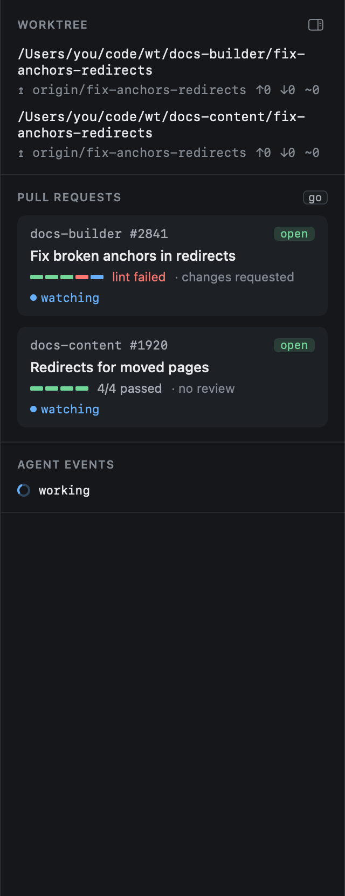

# The inspector

The inspector, on the right of the Sessions view, shows the selected session's surroundings.

- **Worktrees**: each worktree's path, its upstream, how far ahead and behind it is, and whether it has uncommitted
  changes.
- **Pull requests**: each tracked PR with its checks bar, its review state, and whether review feedback is being
  watched. `go` opens the [PR overlay](../github/review-feedback.md).
- **Agent events**: the latest states the agent reported, newest first.

`zi` collapses and expands the inspector. It also gives way first when the window is narrow.
