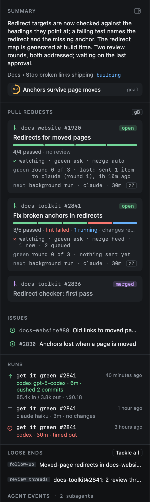
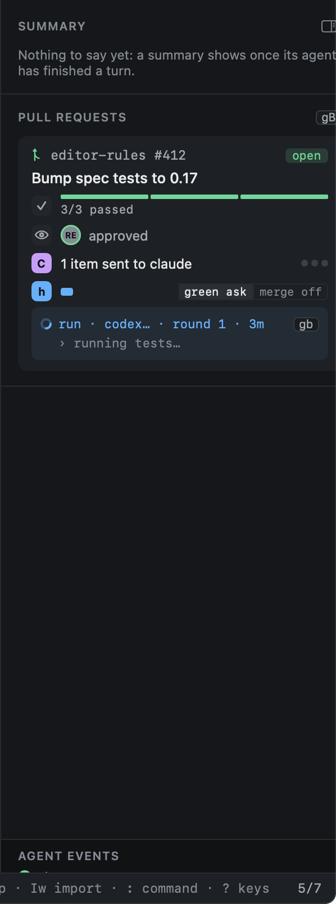
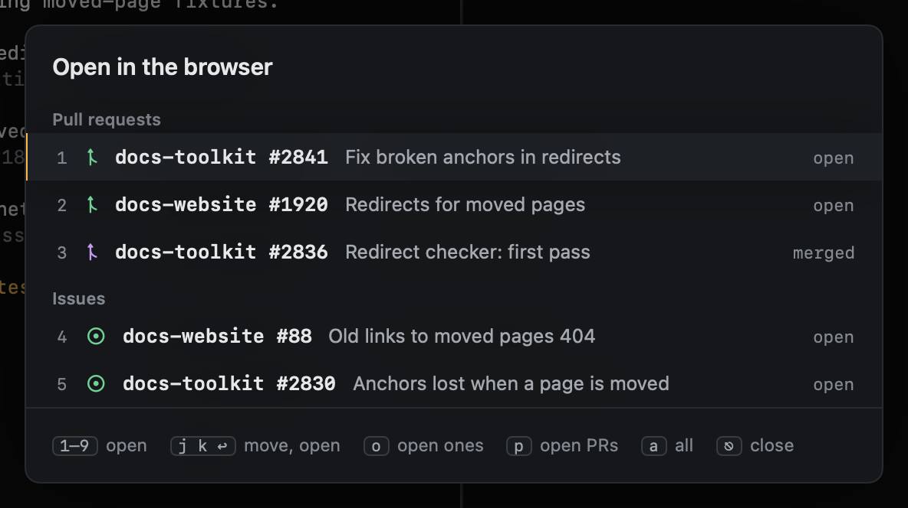

# The inspector

The inspector, on the right of the Sessions view, shows the selected session's surroundings. The top part scrolls; the
parts at the bottom stay put, each kept small, and each shows only when it has something to say.

At the top, scrolling:

- **Summary**: what the session is about, a few sentences from its [ledger](../history/ledger.md) entry while that is
  fresh, else from what its agent said last. Under it, the [Mindmap](../history/mindmap.md) campaign its work sits in
  and that campaign's stage, and its goal as a pill (click it to go there; right-click to move it to another goal or
  take it off).
- **Pull requests**, open first, then merged, then closed, each newest first. An open PR shows its checks bar, its review
  state and what heed is doing about it; a merged or closed one shrinks to its number and title.
- **Issues**, open first.
- **Runs**: the session's get it green and get it merged runs.

At the bottom, anchored:

- **Learned decisions**: what was decided in the session's campaign and still stands, pinned ones first. Three lines
  show; the rest scroll. Hover one for all of it.
- **Loose ends**: follow-ups left open around this work, and the ones heed spots itself (red CI, a quiet PR, review
  threads, an unanswered question, unsaved work). Click one to hand it to the session's agent; **Tackle all** hands
  every one over in one prompt (only when the agent is idle and you have not just typed in it). Right-click to mark one
  done.
- **Overlapping sessions**: other open sessions changing the same files in the same repo, with those files. Click one
  to go to it.
- **Agent events**: the latest state the agent reported, on one line, with how many subagents it has running. Click
  the header for the rest: the agent's model and what it used, as far as its [hooks](../agents/hooks.md#model-and-usage)
  tell (`claude · model-a · 12.3k in / 4.1k out · ≈$0.42 · ctx 38%`), its subagents, and the latest states, newest
  first.
- **The worktree**: its path with `↑` (commits not pushed), `↓` (behind) and `~` (files not committed). Click to copy
  the path; right-click to open a shell in a pane beside the agent or in a new tab.

## Links

**Click a link** to open it on GitHub. `go` opens the session's PR in the [PR overlay](../github/review-feedback.md),
and the issue reader is a key away in the [Issues view](../github/reading.md). A **right-click** on a PR card offers
the pilot's commands for that PR alone ([right-click](../keyboard/mouse.md)).

A session's issues come from three places:

- its prompt's closing words: `Fixes #12`, `Closes org/repo#3`, `Resolves <issue URL>`. Start work from
  [Issues](../github/issues.md) writes these for you;
- the issues its PRs close, as GitHub reports them;
- `heed issue add <url>` from the agent, or `gI` (`:issue.add <url>`; the copied URL when you give none).
  `:issue.remove` takes one off.

A PR with a [run](../github/watch.md#runs) working on it says so on its card: the agent and model, the round, how long,
and the key to its tab (`gb`), with the last line of the run's screen under it. Click the box to go to the tab.

With no PR and no issue yet, the inspector says what comes next. A pushed branch offers **Open a PR on GitHub**, the
compare page for the branch.

### Opening them in the browser

| Key | |
|---|---|
| `gB` | One link opens it. Several open a picker: `1`–`9` opens one, `j` `k` `↩` too, `a` opens all, `⎋` closes. None opens the repo. |
| `gl` | The same picker, even with one link |
| `gR` | The repo on GitHub (a session in several repos asks which) |

In the other views `gB` opens the item under the cursor and `gR` its repo.

## Runs

A session's get it green and get it merged runs list under **Runs**: the agent and the model it was asked to use (and
the one it actually ran, when its hooks report another), how long it took, how it went, and its tokens and `≈` cost.
Click one to read it: the same, its branches and its last screen.

`zi` collapses and expands the inspector. It also gives way first when the window is narrow.
