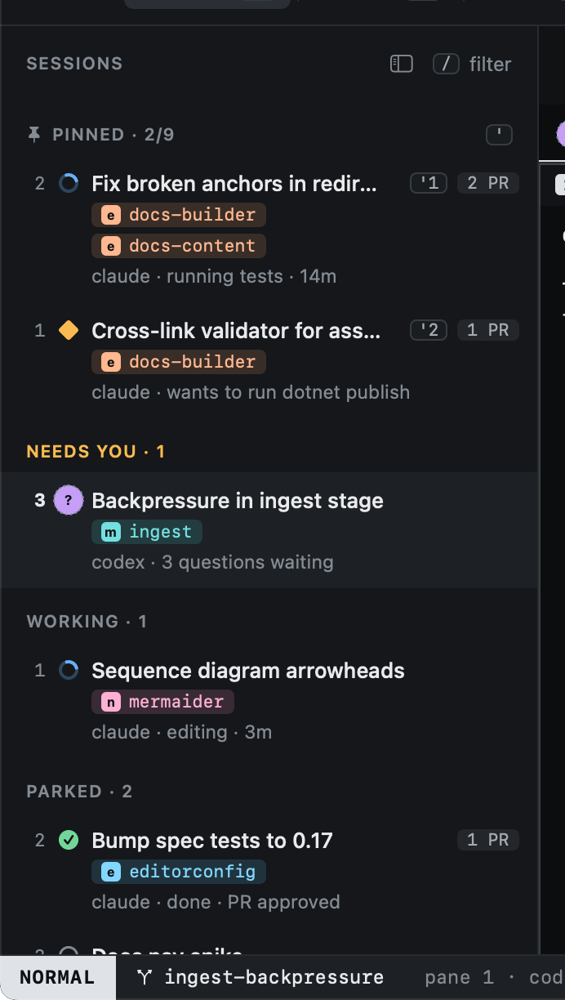
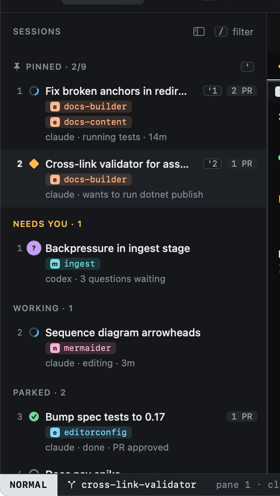

# Moving around

Moving between sessions works like moving in vim.

| Key | Moves to |
|---|---|
| `j` / `k` | The next / previous session (also `↓` / `↑`) |
| `gg` / `G` | The first / last session |
| `3j` | Three sessions down: a count repeats any move |
| `ga` | The next session that needs you (blocked or asking) |
| `''` | The session you were on before |
| `'1` … `'9` | Pinned session 1 to 9 |

Clicking a session selects it too. [Hints](../keyboard/hints.md) (`f`) jump to any session or pane by label.

`ga` is the key to remember: it always takes you to whoever is waiting, wherever you are.

