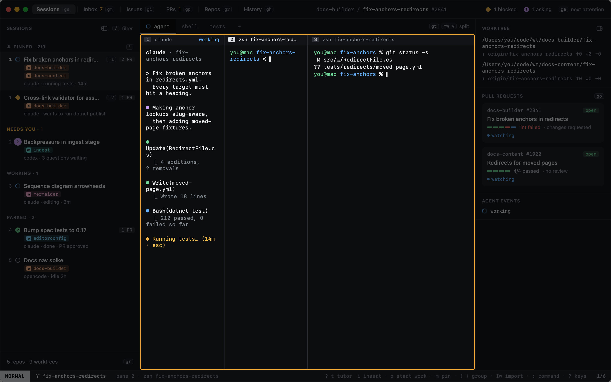
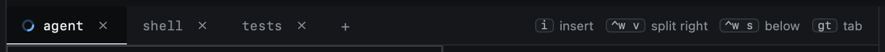
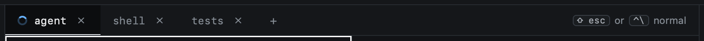
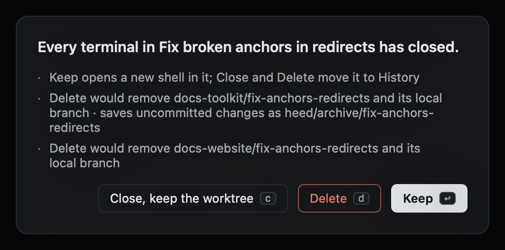
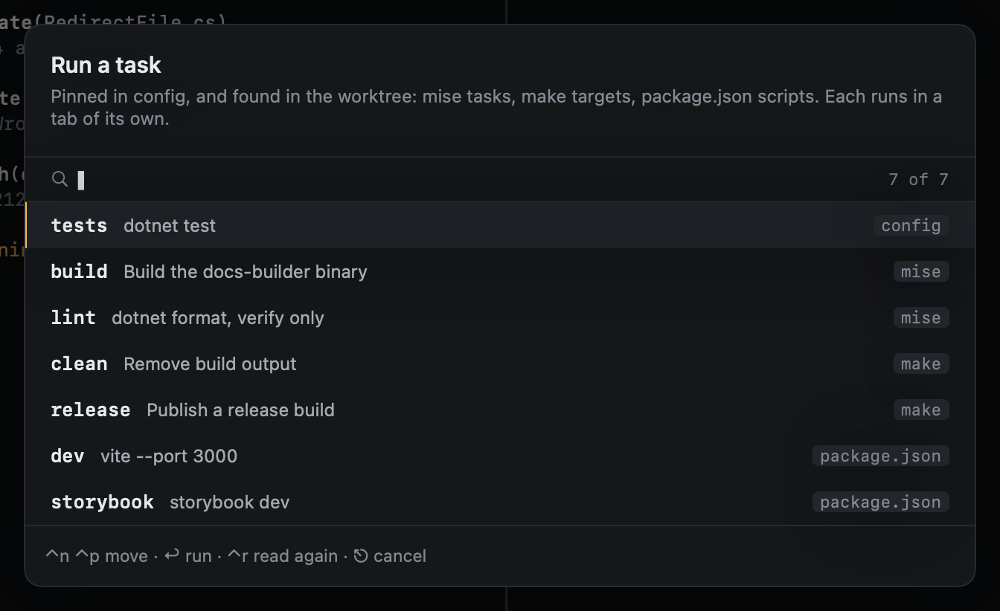
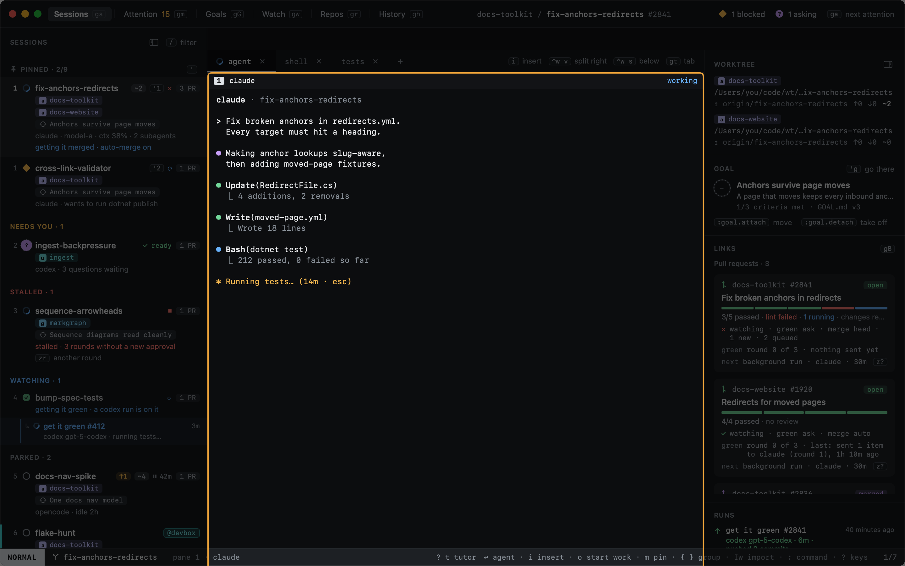

# Panes and tabs

A session's terminals are panes, arranged in tabs. Pane keys start with `⌃w`, as in vim.

| Key | |
|---|---|
| `⌃w v` | Split right |
| `⌃w s` | Split below |
| `⌃w h` `⌃w j` `⌃w k` `⌃w l` | Focus the pane left, below, above, right (`h` and `l` alone work too) |
| `⌃w z` | Zoom the focused pane (again to unzoom) |
| `⌃w q` | Close the focused pane; the agent's pane asks first |
| `gt` / `gT` | Next / previous tab |
| `gn` | New tab with a shell (or click `+`) |
| `⌃w c` | Close the tab and every pane in it (or click its `×`); a tab with the agent asks first |





The right of the tab strip shows the keys that matter where you are looking, as you have them bound: in NORMAL,
`i` to type into the pane, the splits and the next tab; in INSERT, how to get back out.



## When terminals end

A pane closes when its terminal ends: `exit` or `⌃D` in a shell, or a command that finishes. The last pane of a tab
takes the tab with it.

When a session has no terminal left, whether by `exit`, `×` or `⌃w q`, heed asks what to do with it. The safe
answer is the default one:

- **Keep** (`↩`, `y` or `⎋`): the session stays, with a new shell in its worktree.
- **Close, keep the worktree** (`c`): the session moves to History; the worktree stays.
- **Delete** (`d`): the session moves to History and its worktree is removed, with its local branch. A worktree with
  work not saved anywhere else is kept, and the dialog says so.

Terminals that end together across several sessions were lost, not closed (heed quitting, or being replaced while it
runs), and no session is touched: they reopen on the next launch. The same goes for every terminal while heed quits.



New sessions open with the agent alone; set `shell_split = true` under `[sessions]` for a shell beside it.

## Task tabs

Pinned tasks open as tabs in new sessions, one each, running their command. The tab's glyph shows the last run: done
when it passed, a red square when it failed.

```toml
[repos."elastic/docs-builder".tasks]
test = "dotnet test"
```

`!` (`:task.run`) runs any task of the session's worktree in a new tab of the same kind. The picker lists the pinned
tasks, then what heed finds in the worktree, each marked with where it comes from:

- **mise**: the repo's own tasks from `mise tasks ls`, not global or hidden ones, run with `mise run`. A mise config
  that is not trusted yet offers none, and the picker says so.
- **make**: the Makefile's targets, with the description from a `target: ## Description` comment, run with `make`.
- **package.json**: its scripts, without install and publish hooks or a script's `pre` and `post` hooks, run with the
  repo's package manager: `pnpm run`, `bun run` or `yarn` by its lockfile, else `npm run`.



Type to narrow the list, `↩` runs the task under the cursor. What a worktree offers is read the first time the picker
opens on it; `⌃r` in the picker (`:task.refresh`) reads it again, after a branch added a target or you trusted a mise
config. `:task.run <name>` runs one by name without the picker.

## Zoom


