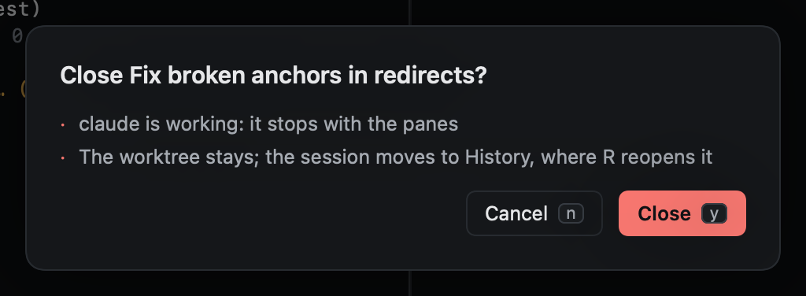
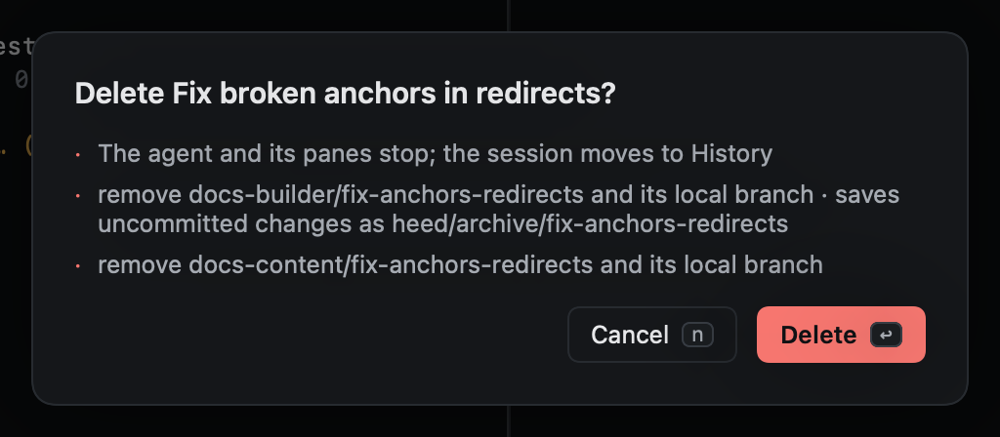

# Pin, park, close, delete

| Key | Does | Keeps |
|---|---|---|
| `m` | Pin or unpin (mark, as in vim): pinned sessions stay at the top, and `'1`–`'9` jump to them | Everything |
| `zz` | Park: move the session out of the way, to **Parked** | Everything; the agent keeps running |
| `x` | Close: the agent and panes stop, the session goes to History | The worktree and branch |
| `dd` | Delete: close, and remove its worktrees and their local branches | Unpushed and uncommitted work, saved first |

Pinned sessions are never removed by [cleanup](../worktrees/cleanup.md).

For a [chat](chats.md), `dd` removes its scratch folder instead. A folder you picked for a chat is never removed.

## Closing and deleting ask first

Both ask before doing anything, and say exactly what will happen. `y` or `↩` goes ahead; `n`, `⎋` or `q` cancels.

Deleting never loses work: uncommitted changes and unpushed commits are [saved first](../worktrees/removing.md#saved-first)
as `refs/heed/archive/<branch>`, and the dialog says so for each worktree.

Closed and deleted sessions stay in [History](../history/index.md), where `R` reopens them (recreating the worktree
from its branch, or from what was saved when the branch is gone).
