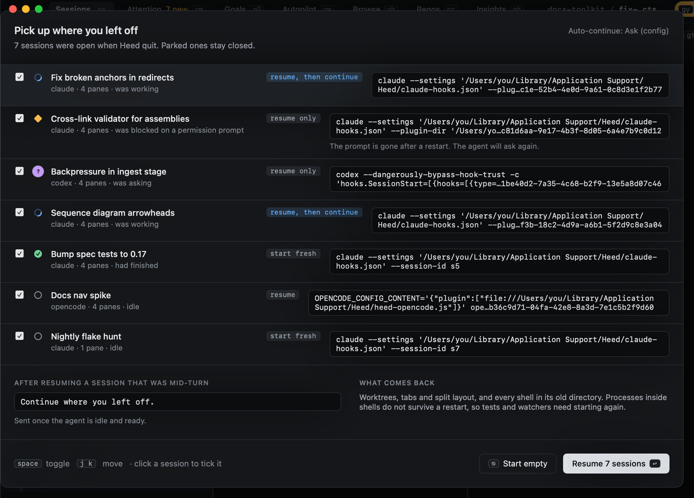
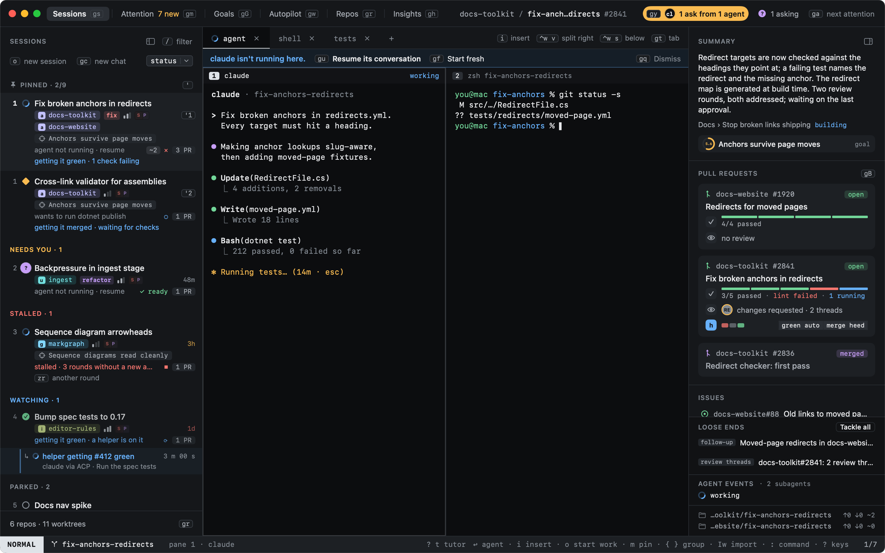

# Resuming sessions

When Heed starts, the sessions that were open come back. (With `persist = "zmx"` their agents never stopped, and
their panes reattach instead: see [Agents that outlive Heed](zmx.md).) Whether their agents resume is up to `resume_on_launch`
under `[sessions]`:

| Value | On launch |
|---|---|
| `ask` | List the sessions that were open, all ticked, and let you untick the ones to leave closed (the default) |
| `always` | Resume the ones that were working, blocked or asking; idle and finished ones stay closed |
| `never` | Open plain shells; resume by hand |



In the dialog, `space` (or a click on its row) ticks or unticks a session, `↩` or **Resume N sessions** resumes the
ticked ones, and `⎋` or **Start empty** leaves them all closed. A click beside the dialog does nothing, so it never
starts empty by accident.

Resuming uses each agent's own resume (`claude --resume <id>`, `codex resume <id>`, …) with the session id Heed kept.
If the agent no longer has that session, Heed says so and starts the agent fresh with the original prompt.

## Resuming later

Start empty, or skipping a session, leaves it as a plain shell with no agent. So does an agent that exited and left
its shell behind. Neither is lost: while Heed still has the agent's session id and the agent still has that
conversation, a strip across the top of the session's panes says so, and the session's row in the sidebar reads
"agent not running · resume".




| Key | Button | What it does |
|---|---|---|
| `gu` | **Resume its conversation** | Resumes the agent's conversation, as the dialog does (`claude --resume <id>`, `codex resume <id>`, …). If the agent no longer has it, Heed says so and starts the agent fresh with the original prompt. |
| `gf` | **Start fresh** | Starts the agent again from the session's original prompt, as a new conversation. |
| `gq` | **Dismiss** | Hides the banner for this session until Heed restarts. The keys, the menus and the row keep working. |

## Resume any time

The banner is only the offer. The same actions are always in the session's right-click menu (the row in the sidebar)
and the Session menu in the menu bar, with the same keys:

| Key | Menu item | What it does |
|---|---|---|
| `gu` | **Resume its agent** | Resumes the agent in the session's agent pane, whether or not the banner shows. |
| `gY` | **Copy resume command** | Puts the exact line Heed would run on the clipboard. |
| `gf` | **Start its agent fresh** | Starts the agent again from the session's original prompt. |

What **Resume its agent** runs depends on what Heed knows. Every line is built the way the launch dialog and the banner
build it, so the hooks, the telemetry settings, the sign-off arguments and the environment are the same as in a normal
start. Resuming replaces the pane's shell with the agent, as the launch dialog does.

| Heed knows | What runs |
|---|---|
| The agent's session id, and the agent still has the conversation | The agent's own resume with that id. If the agent turns out to have lost it, Heed says so and starts it fresh from the original prompt. |
| The agent's session id, but Heed cannot find the conversation (or has not checked yet) | The agent's own resume with that id anyway. If the agent has no such conversation, it says so in the pane. |
| No session id | The agent's latest conversation in the session's folder: `claude --continue`, `codex resume --last`, `opencode --continue`, `pi --continue`. gemini and cursor have no such form that Heed has checked, so Heed says so and leaves **Start its agent fresh** to you. |

An agent already running is never touched. While an agent runs in one of the session's panes, **Resume its agent**
and **Start its agent fresh** stay in the menu, greyed out, with the reason in the text ("agent running in pane 2"),
and `gu` and `gf` only say so. Nothing is typed into the pane and no pane is opened. **Copy resume command** stays on:
it only copies text.

The other greyed-out cases name their reason too: the session has no agent or no pane; it is parked (unpark it
first); or it is on a host, where its agent lives in zmx and the hooks Heed would put on the line are this Mac's
(reattach there; **Copy resume command** is off for a host session for the same reason).

### The copied line

**Copy resume command** copies one line that runs in your shell, from the session's folder, now or after Heed has quit:

```
cd '/Users/you/code/wt/app/fix-login' && claude --settings '/Users/you/Library/Application Support/Heed/claude-hooks.json' --resume 3f2a…
```

The hooks are a file in Heed's support folder, which Heed keeps, so the line stays valid when Heed is not running.
Run it in a terminal pane of that session in Heed and its hooks report to Heed as usual; Heed's own pane carries the
token that proves where they come from. Run it anywhere else and the agent works the same, but Heed ignores what its
hooks say. Nothing that looks like a credential is copied: names with `TOKEN`, `KEY`, `SECRET`, `PASSWORD`, `AUTH`,
`BEARER`, `COOKIE` or `HEADERS` in them are left off the line, and Heed's own launch puts none of them there to begin
with (its hooks, telemetry and plugins are files, local endpoints and flags). A flash shows the line, and any names left
off.

The banner shows when all of these are true:

- the session is not parked and not on a host (an agent on a host stays alive in zmx there);
- its agent can resume, and Heed kept its session id, and the agent still has that conversation (for claude, its
  transcript is on disk; a session whose agent never got as far as a first turn has none, so there is nothing to offer);
- no agent pane or shell pane of the session has an agent running. An agent Heed started or resumed, one whose hooks
  report in, one that survived in zmx, and an agent you started by hand in a split all count as running; a task's or a
  helper's agent does not. The session's saved state (working, done) is not used: after a restart it only says what
  was true then.

A chat with a conversation to continue gets the banner like any session; one with nothing to resume does not.

## The continue prompt

A session that was mid-turn when Heed quit gets a nudge once its agent is idle again: `continue_prompt`, by default
"Continue where you left off.". Set it to `""` to turn it off.
