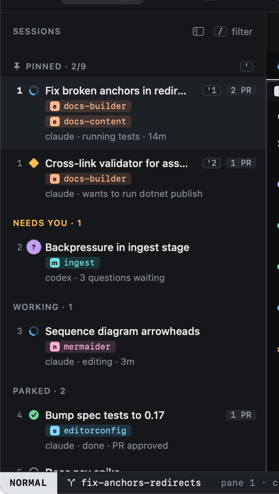
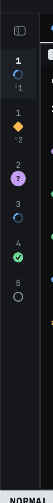

# The sidebar

The sidebar lists every open session, grouped so that whatever needs you is near the top.

| Group | Holds |
|---|---|
| **Pinned** | Sessions you pinned with `p`, in the order you pinned them. `'1` to `'9` jump to them. |
| **Needs you** | Blocked or asking: an agent waiting on you. |
| **Working** | Agents busy on their task. |
| **Parked** | Sessions you set aside with `zz`, and finished ones. |

Each row shows the session's state glyph, its title, its repos (one chip per worktree), the agent and what it is doing,
and how many pull requests it tracks. The numbers on the left are relative to the cursor, as in vim: the number on a
row is how many `j` or `k` presses away it is.

The footer counts repos and worktrees; `gr` opens [Repos](../worktrees/index.md).

## The rail

`zs` collapses the sidebar to a narrow rail: one row per session with its number, state and pin, so moving and jumping
still work. `zs` again brings the sidebar back.

