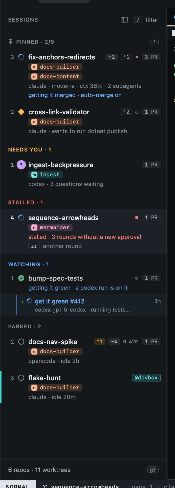

# The sidebar

The sidebar lists every open session, grouped so that whatever needs you is near the top.

| Group | Holds |
|---|---|
| **Pinned** | Sessions you pinned with `m`, in the order you pinned them. `'1` to `'9` jump to them. |
| **Needs you** | Blocked or asking: an agent waiting on you. Also a PR with feedback and no session to send it to. |
| **Stalled** | A PR of the session used its get-it-green rounds without a new approval, so heed stopped sending. `zr` gives it another round. |
| **Working** | Agents busy on their task. |
| **Watching** | Heed is getting a PR of the session green or merged. Leave these be. |
| **Parked** | Sessions you set aside with `zz`, and finished ones. |

Each row shows the session's state glyph, its worktree's name (hover it for the title from the prompt), its repos (one chip per worktree, then one per repo it opened a
PR in), the agent (and, when it is not working, what it waits on: the spinner says it is working), and how many pull
requests it tracks. Once its agent has reported usage, the agent's line also names the model it runs (shortened:
`claude · model-a · ctx 38%`) and, while it works, how full its context is, in amber from 80%. Work not shared yet
shows as chips on the first line: `↑2` in amber for commits not pushed, `~3` for files not committed, summed over the
session's worktrees and only when there are any (hovering `↑` says when no PR carries those commits yet). The numbers
on the left are relative to
the cursor, as in vim: the number on a row is how many `j` or `k` presses away it is.

A session with a get it green or get it merged [run](../github/watch.md#runs) working gets a second row under it, in
any group: `↳`, the goal and PR (`get it green #412`), how long it has run, then its agent and model and the last line
of its screen. Click it to go to the run's tab. The rail leaves it out.

Click a session to select it; double-click it to type into its agent (INSERT). Rows in the other lists (Watch,
Inbox, Issues, PRs, Repos, History) take clicks the same way: a click moves the cursor there, a double-click opens the
row as `↩` does. A right-click opens a menu of what you can do with it, each item with its key
([right-click](../keyboard/mouse.md)).

## Watching

A session is in Watching while heed is doing something about one of its PRs: feedback sent and not yet addressed, get
it green on `auto` with checks failing or threads open, or merging on and the PR on its way. Its row is a single line,
with what heed is doing in place of the agent's line (`getting it green · 2 checks failing`, `getting it merged · next
run`); the cursor row shows everything. The agent's spinner still shows while it works on what heed sent.

**Typing makes it yours.** Once you type into a session, it goes back to Working or Parked, by its agent's state, and
stays there until heed next does something on one of its PRs (sends feedback, updates the branch, merges). So a session
you keep working in, that has PRs in flight, stays where you work. Its PRs still show their state on the row.

**Pinned sessions stay pinned.** Heed's line shows under the agent's whenever heed is getting one of its PRs green
or merged, or one is stalled, typed in or not.

**Needs you comes first.** An agent that asks or is blocked is in Needs you, whatever heed is doing. And a session you park (`zz`) stays in Parked while heed works on its PRs.

The cursor stays on its session. When a session changes group (a parked agent starts working, or one starts asking),
the rows move but the selection does not, so what you are looking at, and typing into, never switches under you. Heed
does not move the session under the cursor at all: a session it starts or stops watching changes group when you move
off it. What you do yourself (pin, park) and what needs you show at once.

The footer counts repos and worktrees; `gr` opens [Repos](../worktrees/index.md).

## The rail

`zs` collapses the sidebar to a narrow rail: one row per session with its number, state and pin, so moving and jumping
still work. `zs` again brings the sidebar back.

