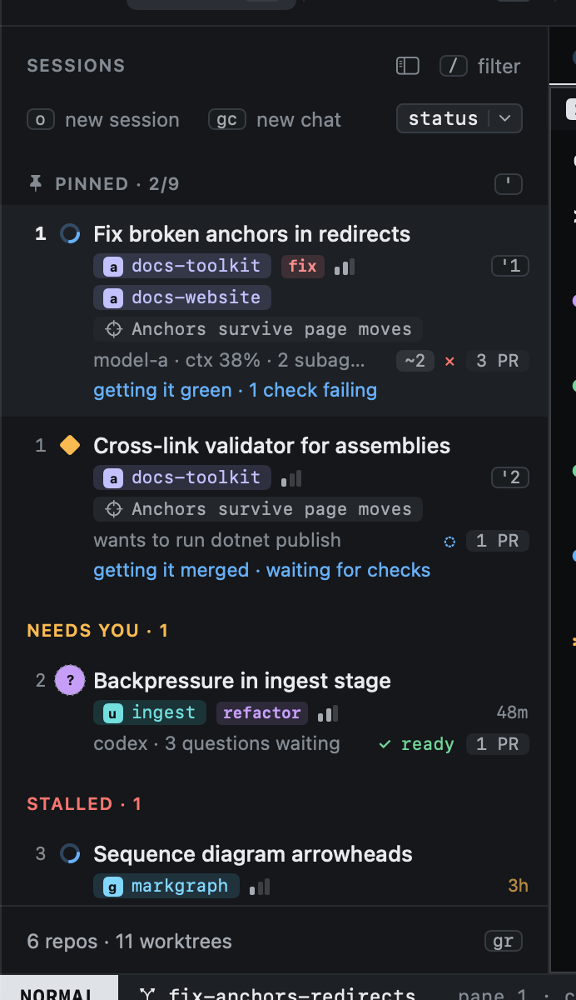
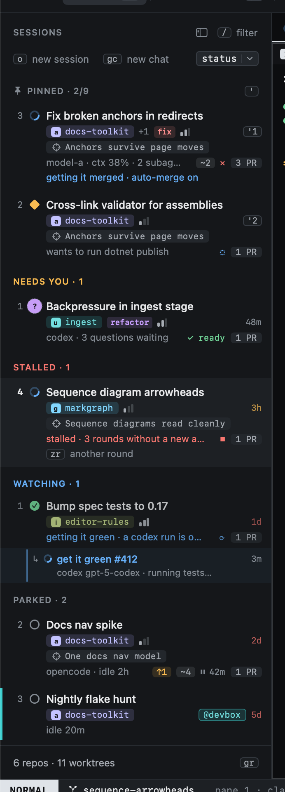
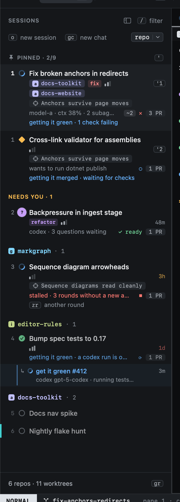
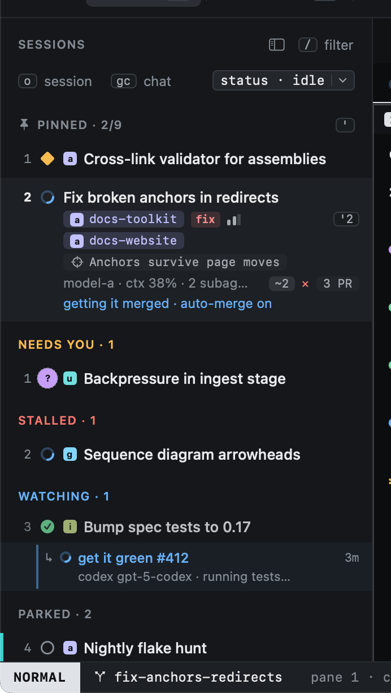
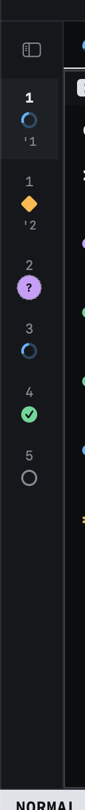

# The sidebar

The sidebar lists every open session, grouped so that whatever needs you is near the top.

Under the header, **new session** and **new chat** run what `o` and `gc` do; each shows its key as you have it bound.

| Group | Holds |
|---|---|
| **Pinned** | Sessions you pinned with `m`, in the order you pinned them. `'1` to `'9` jump to them. |
| **Needs you** | Blocked or asking: an agent waiting on you. Also a PR with feedback and no session to send it to. |
| **Stalled** | A PR of the session used its get-it-green rounds without a new approval, so heed stopped sending. `zr` gives it another round. |
| **Working** | Agents busy on their task. |
| **Watching** | Heed is getting a PR of the session green or merged. Leave these be. |
| **Chats** | [Chats](chats.md): sessions with no repo or worktree. One that asks or is blocked is in Needs you instead. |
| **Parked** | Sessions you set aside with `zz`, and finished ones. |

Each row shows the session's state glyph and its worktree's name (`zt` shows titles instead; hover for the other) on
a line of its own, so it has the row's whole width. Under it, its first repo, `+2` for the others it touches (one chip
per worktree, then one per repo it opened a PR in, all of them on the cursor's row), how long since you last touched
it, and its pin key (`'1`). Below that, the agent's
line: its model (shortened: `model-a · ctx 38%`) and, while it works, how full its context is, in amber from 80%; when
it is not working, what it waits on. The agent's name shows only when it is not your default agent. At the end of the
agent's line sit what the session holds: `↑2` in amber for commits not pushed, `~3` for files not committed (summed
over its worktrees, only when there are any; hovering `↑` says when no PR carries those commits yet), heed's mark on
its PRs, and how many it tracks. The numbers on the left are relative to the cursor, as in vim: the number on a row is
how many `j` or `k` presses away it is.

**How long you have been away.** The age on a row (`48m`, `3h`, `2d`) is the time since you last typed in the session
or went into it, not since its agent last did something. It shows from 15 minutes, in grey, then amber past an hour
and rust past a day.

A session with a get it green or get it merged [run](../github/watch.md#runs) working gets a second row under it, in
any group: `↳`, the goal and PR (`get it green #412`), how long it has run, then its agent and model and the last line
of its screen. Click it to go to the run's tab. The rail leaves it out.

Click a session to select it; double-click it (or press `↩`) to type into its agent (INSERT). Rows in the other lists (Attention,
Watch, Repos, History and the rest) take clicks the same way: a click moves the cursor there, a double-click opens the
row as `↩` does. A right-click opens a menu of what you can do with it, each item with its key
([right-click](../keyboard/mouse.md)).

## Watching

A session is in Watching while heed is doing something about one of its PRs: feedback sent and not yet addressed, get
it green on `auto` with checks failing or threads open, or merging on and the PR on its way. Its row is a single line,
with what heed is doing in place of the agent's line (`getting it green · 2 checks failing`, `getting it merged · next
run`); the cursor row shows everything. The agent's spinner still shows while it works on what heed sent.

**Typing makes it yours.** Once you type into a session, it goes back to Working or Parked, by its agent's state, and
stays there until heed next does something on one of its PRs (sends feedback, updates the branch, merges). So a session
you keep working in, that has PRs in flight, stays where you work. Its PRs still show their state on the row.

**Pinned sessions stay pinned.** Heed's line shows under the agent's whenever heed is getting one of its PRs green
or merged, or one is stalled, typed in or not.

**Needs you comes first.** An agent that asks or is blocked is in Needs you, whatever heed is doing. And a session you park (`zz`) stays in Parked while heed works on its PRs.

The cursor stays on its session. When a session changes group (a parked agent starts working, or one starts asking),
the rows move but the selection does not, so what you are looking at, and typing into, never switches under you. Heed
does not move the session under the cursor at all: a session it starts or stops watching changes group when you move
off it. What you do yourself (pin, park) and what needs you show at once.

## Grouping and sorting

The dropdown at the end of the **new session** row says how the list is grouped and sorted, and changes it. Each choice
is a command too, with a key in the sidebar:

| | Key | Choices |
|---|---|---|
| Group | `zG` (`:sessions.group repo`) | **status** (the groups above), **campaign** (the [Mindmap](../history/mindmap.md) campaign the work is in, Unplaced for the rest), **repo** (each session's first repo), **none** |
| Sort | `T` (`:sessions.sort idle`) | **attention** (as they came, Parked last touched first), **you, recent first**, **idle longest**, **started** (newest first) |
| Rows | `zR` (`:sessions.rows one`) | **two lines**, or **one line** each: the state, the repo's mark and the title alone; the cursor's row in full |

Whatever groups the rest, **Pinned** and **Needs you** stay on top. Grouped by campaign or repo, a parked session stays
in its group, after the live ones, on one quiet line; a group sits where its first live session comes in the sort.
Grouped by repo, a row leaves out the repo its header names. The choice is kept on this Mac.

The footer counts repos and worktrees; `gr` opens [Repos](../worktrees/index.md).

## The rail

`zs` collapses the sidebar to a narrow rail: one row per session with its number, state and pin, so moving and jumping
still work. `zs` again brings the sidebar back.

