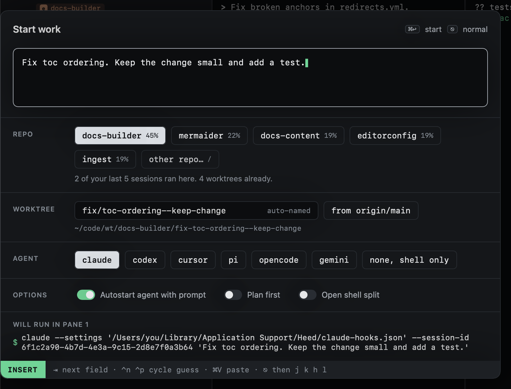

# Starting again

`O` opens Start work with the prompt of the session you are on, ready to change and start again: a second attempt,
another agent, another repo. In [History](../history/index.md), `O` does the same for a closed session.

To pick up the same session where it stopped instead, reopen it from History with `R`.
