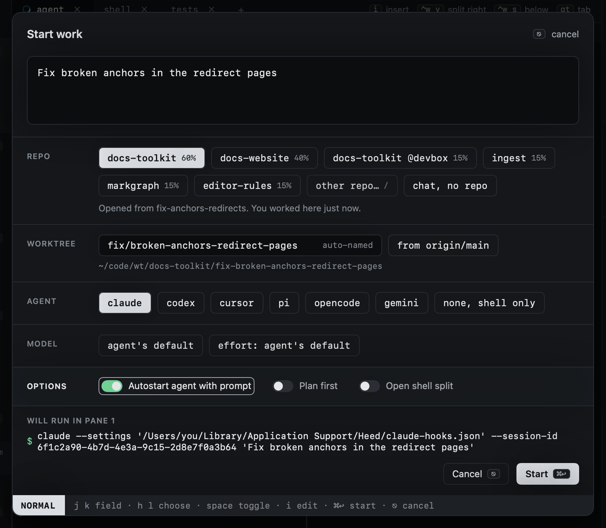
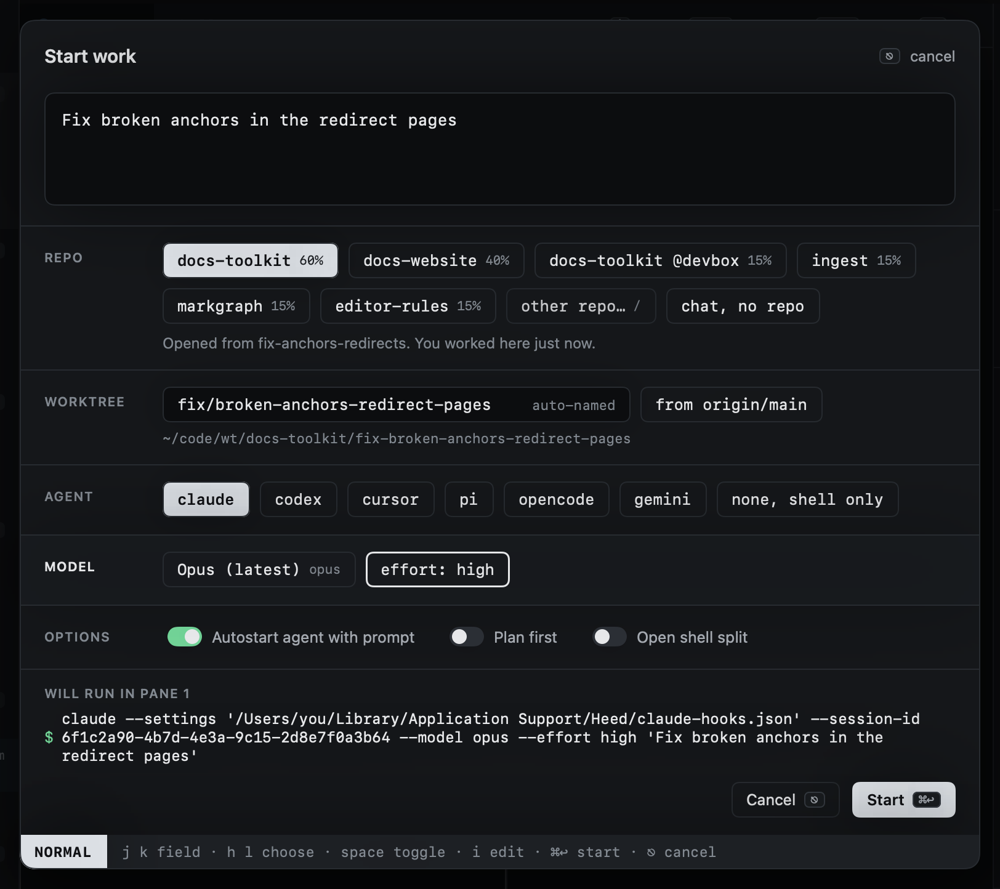

# Agent and options

The agent row lists every agent Heed knows, plus **none, shell only**. `default_agent` under `[sessions]` picks the
one selected first.

## Model and effort

Below the agent, **Model** picks what it runs on: the agent's default, one of its [known models](../agents/models.md)
(newest first, by name and id), or **Custom…**, which takes any id the agent accepts. `h l` step through them, a
click opens the list, and on Custom… `i` types the id; Start work does not start while it is empty. Beside it, for an
agent that takes one, the reasoning effort (claude's `--effort`, codex's `model_reasoning_effort`, pi's
`--thinking`). A model without an effort level drops it, and another agent starts on its own defaults again.

## Options

| Option | |
|---|---|
| **Autostart agent with prompt** | Start the agent in its pane on the prompt. Off opens the pane with a plain shell. |
| **Plan first** | Start the agent in its planning mode where it has one (claude's `--permission-mode plan`). |
| **Open shell split** | A shell beside the agent. Defaults to `shell_split` under `[sessions]`. |

## The command preview

**Will run in pane 1** shows the exact command line: the agent, the hook wiring Heed passes for this run (see
[Hooks](../agents/hooks.md)), the session id it will resume by, and your prompt.
