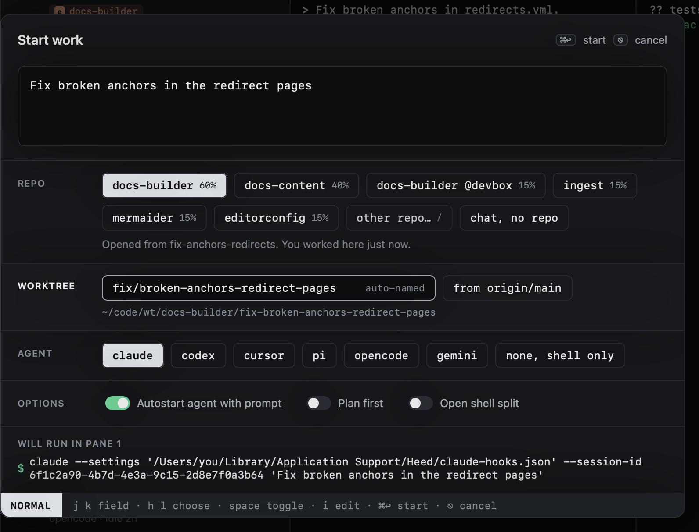

# Branch names

The worktree field fills itself from your prompt: a prefix picked by the first word, then the words that matter.
"Fix broken anchors in the redirect pages" becomes `fix/broken-anchors-redirect-pages`. The worktree folder uses `-`
for `/`.



Type in the field to name it yourself; it stops following the prompt once you do.

With [smart guesses](repos.md#smart-guesses) on, the name from the rules shows straight away. Once you pause typing,
Apple's on-device model suggests better words: up to five, taken from the task rather than its first words, in the
style of your recent branch names. "look why deploys are so slow lately" becomes `perf/slow-deploys` instead of
`feature/look-why-deploys-slow`. Its suggestion is cleaned to lowercase letters, digits and `-`, and loses a first
word that repeats the prefix. It replaces the name only while you have not typed one.

## Prefixes

The first word picks the prefix; anything else gets `default_prefix` (`feature`; `""` for none). With smart guesses
on, a prompt whose first word picks no prefix gets one the model chooses from the prefixes below instead. With
`default_prefix = ""`, a prompt like that gets no prefix, as before.

```toml
[worktrees]
default_prefix = "feature"

[worktrees.prefixes]
fix = ["fix", "bug", "broken", "crash", "repair", "resolve"]
bump = ["bump", "upgrade", "update"]
chore = ["chore", "cleanup", "tidy", "remove", "rename"]
refactor = ["refactor", "restructure", "simplify"]
docs = ["docs", "doc", "document", "readme"]
test = ["test", "tests", "cover"]
perf = ["perf", "speed", "optimize", "faster"]
feature = ["add", "implement", "support", "create", "introduce", "build", "feature"]
```

Worktrees go under `root` (`~/code/wt` by default) as `<root>/<repo>/<name>`.
