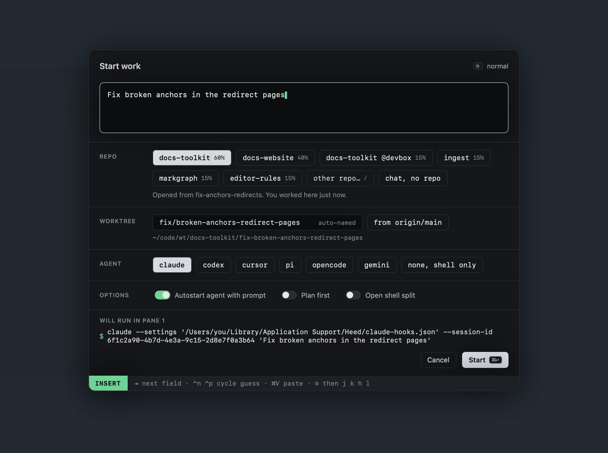

# From anywhere

`⌃⌥Space` opens Start work in a floating panel over whatever app is in front. It takes the keyboard without bringing
Heed forward; `⎋ ⎋` or a click anywhere else closes it, and `⌘↩` starts the session.



Change the shortcut, or turn it off with `""`:

```toml
[keys]
global_start_work = "<C-M-Space>"
```

It needs no Accessibility permission. If another app owns the combination, the status bar says so.

## Tiling window managers

The panel's window title is always `Heed Start Work` (app `build.heed.app`), so a tiling window manager can leave it
floating:

```toml
# OmniWM: ~/.config/omniwm/settings.toml (id is any UUID)
[[appRules]]
bundleId = "build.heed.app"
id = "75CF2DF1-FF34-4187-9CC9-01DD190EFC51"
layout = "float"
titleRegex = "^Heed Start Work$"
```

```sh
# yabai
yabai -m rule --add app="^Heed$" title="^Heed Start Work$" manage=off
```

Without a rule it still works: if a window manager takes focus the moment the panel opens, the panel takes it back.
