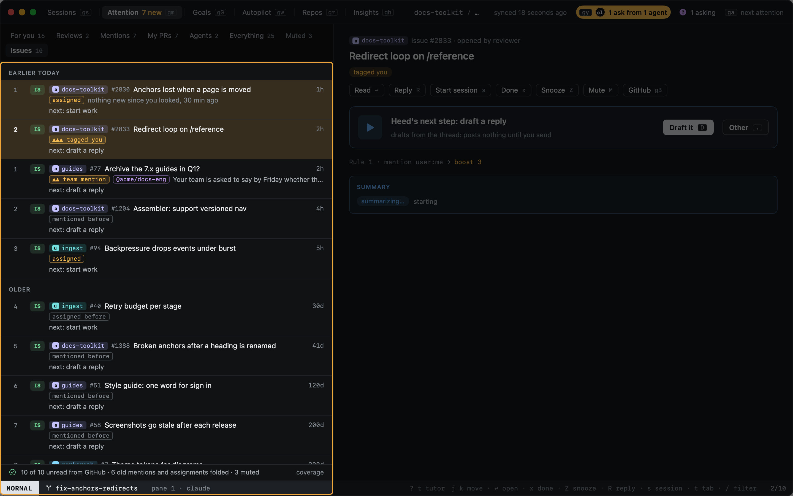
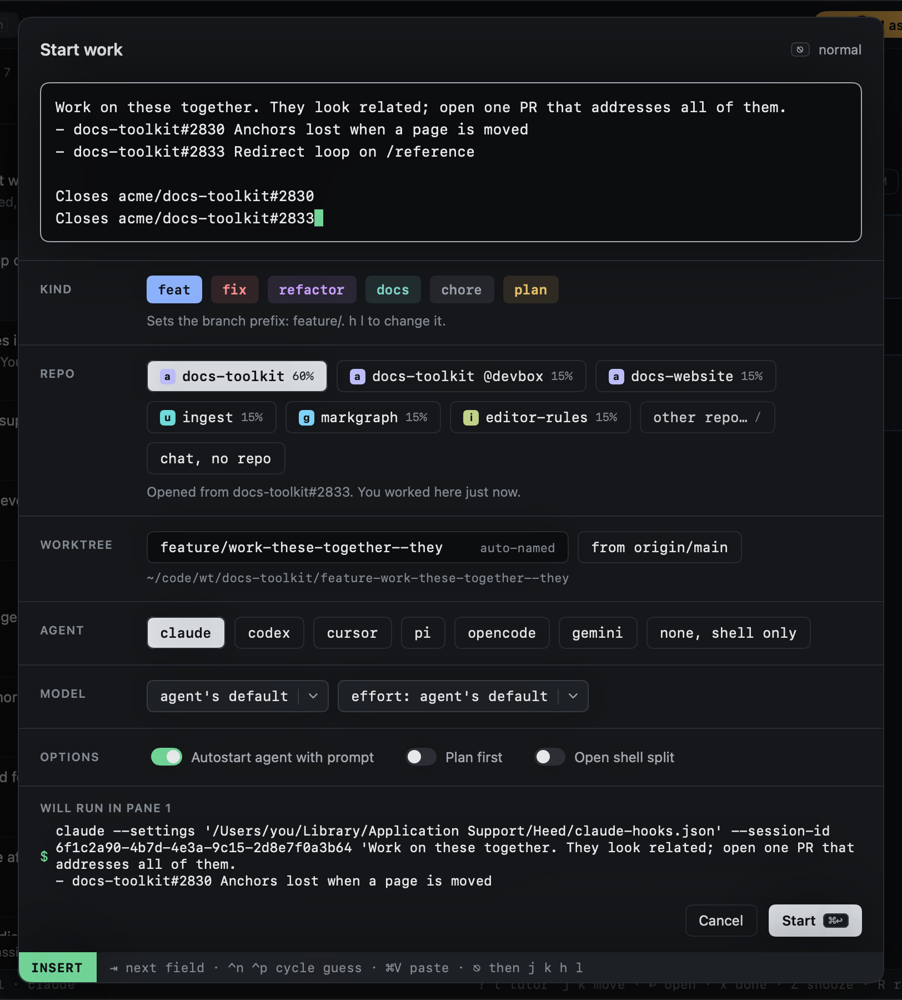

# From GitHub

In [Attention](../github/attention.md) (`gi` lists its issues), pick items with `space` (or a range with `v`), then:

| Key | |
|---|---|
| `s` | Start one session from the picked items: Start work opens with a prompt built from them |
| `a` | Add them to the current session: typed into its agent (not while it is blocked or asking) |

With nothing picked, the item under the cursor is used. The [issue reader](../github/reading.md#issues) has `s` and `a`
too.

