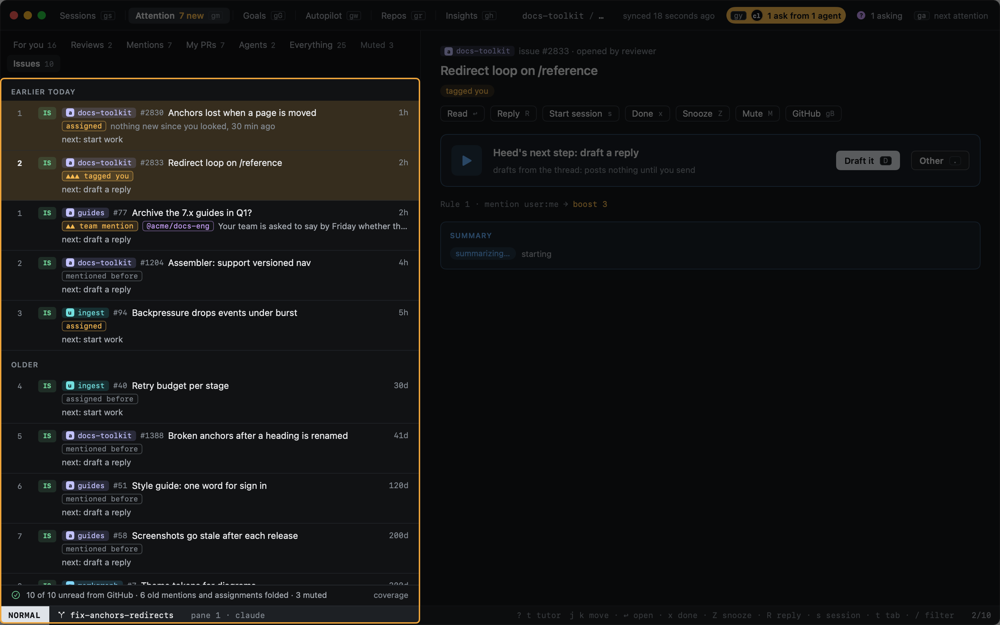
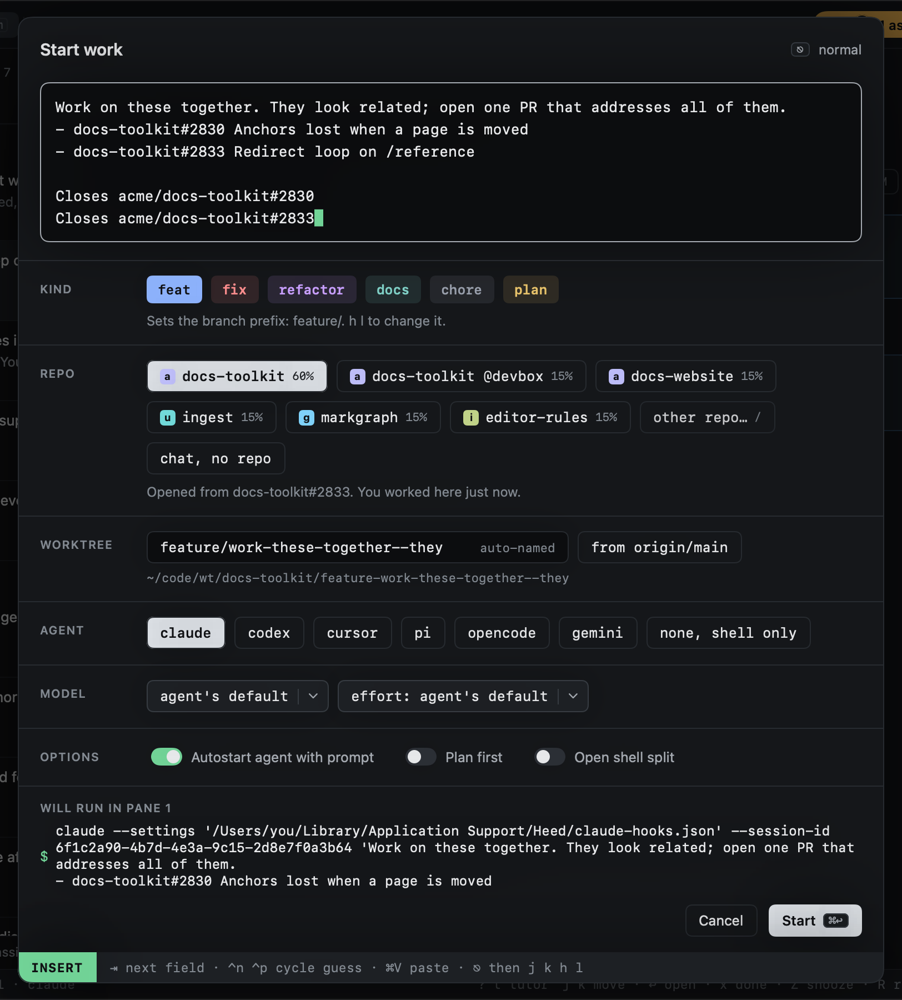

# From GitHub

A PR or an issue can start a session in five places. Each one fills Start work with a prompt, and you read the prompt
before anything starts.

## In Attention

[Attention](../github/attention.md) lists the PRs and issues that want you. Pick items with `space`, or a range with `v`,
then press a key. With nothing picked, the item under the cursor is used.

| Key | |
|---|---|
| `s` | Start one session from the picked items: Start work opens with a prompt built from them |
| `a` | Add them to the current session: heed types them into its agent |

`a` does nothing while the agent is blocked or asking. heed says so and leaves the items picked.

The prompt depends on what you picked:

- **One issue.** The prompt holds its title, the first 1,500 characters of its body, and a `Closes org/repo#12` line.
- **Several issues.** The prompt asks for one PR that addresses all of them, lists each issue, and ends with a `Closes` line for each.
- **Anything else, PRs included.** The prompt says `Look into these:` and lists each item with its number, title and the reason it wants you.

The repo's `start_instructions` setting adds its text to the prompt.

## In Browse

[Browse](../github/browse.md) (`gb`) searches the issues and PRs of an org, a repo or a Project. Pick items with
`space` and press `s` to start one session for all of them (in every repo they are in), `S` for one session per repo, or `G` for a goal. On one
item, `F` Fix, `I` Implement, `C` Chat and `R` Review run an agent in a temporary worktree without going through Start
work, and `s` keeps the run as a session.

## In the readers

The [issue reader](../github/reading.md#issues) has the same `s` and `a`. The [PR reader](../github/reading.md#pull-requests)
has `S`, which starts a new session that continues the PR: the prompt names the PR and lists its review threads and
checks that are not resolved yet.

## By pasting a link

A PR or issue URL in the Start work prompt shows as a chip with its title. heed names the branch from that title. See
[Start work](index.md).

## Onto a running session

- `gU` tracks a PR by URL in the current session. See [Tracking PRs](../github/tracking-prs.md).
- `gI` links an issue to the current session: type its URL, or copy it first. `:issue.remove` takes it off again.

`gi` opens Attention's issues list. The list holds the issues assigned to you or mentioning you.
