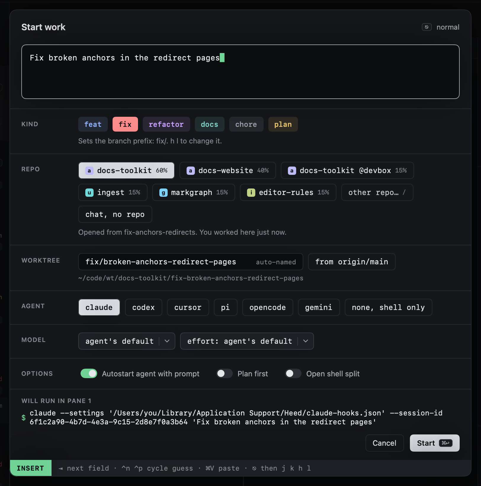
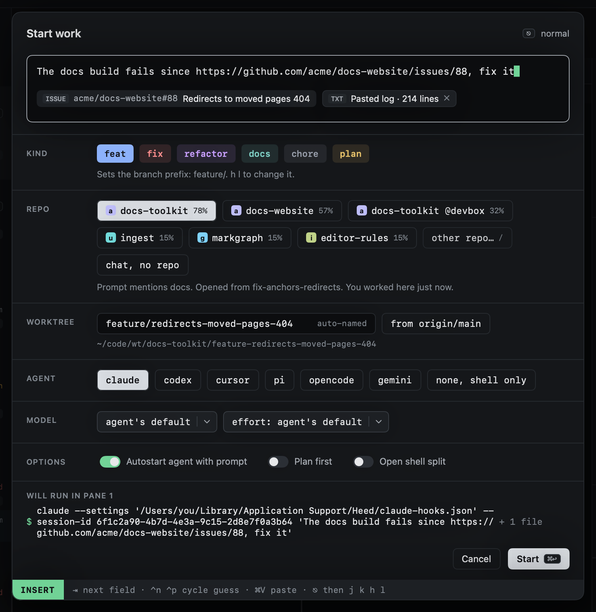

# Start work

`o` opens Start work. Describe the task; Heed picks the repo, names the branch, makes the worktree, opens a session and
starts the agent on your words.

The dialog has its own small modes, like Heed itself:

- **Typing** (INSERT, the default): keys go into the prompt or the worktree name. `⇥` moves to the next field.
- **Moving** (NORMAL, after `⎋`): `j` `k` or `⇥` move between fields, `h` `l` choose within one, `space` toggles,
  `i` or `↩` edits again.

| Key | |
|---|---|
| `⌘↩` | Start |
| `⌃n` / `⌃p` | Cycle the repo guess (or the agent, on the agent row) |
| `⌘V` | Paste at the cursor; a big paste (over 20 lines or 2,000 characters) becomes an attachment |
| `⎋` | Stop typing; again to cancel |

While typing, the cursor moves as in any text field, here and wherever heed takes typing (the `:` line, a `/` filter,
the pickers):

| Key | |
|---|---|
| `←` `→` | A character; `⌥←` `⌥→` a word; `⌘←` `⌘→`, `Home` `End` or `⌃a` `⌃e` the line's start or end |
| `↑` `↓` | A line in the prompt (`⌘↑` `⌘↓` its start or end); in a picker they move the list |
| `⇧` with any of those | Select; typing or pasting replaces the selection. `⌘A` selects all |
| `⌫` `⌦` | The character before or after the cursor |
| `⌥⌫` or `⌃w` | The word before the cursor (at the end of a folder path: up a folder) |
| `⌃u` or `⌘⌫` | Back to the line's start |

| Field | |
|---|---|
| **Prompt** | What you want done. It grows with what you type, up to a third of the window, then scrolls. |
| **Kind** | What the work is: feat, fix, refactor, docs, chore or plan. It picks the branch prefix. See [Branch names](branch-names.md#kind). |
| **Repo** | The guessed repo; another chip or **other repo…** picks a different one. See [Choosing repos](repos.md). The last chip makes it a [chat](../sessions/chats.md). |
| **Worktree** | The branch and folder name, from the kind and the prompt's words. See [Branch names](branch-names.md). |
| **Agent** | Which agent starts, or a shell only. See [Agent and options](agent-and-options.md). |
| **Options** | Autostart, plan first, shell split. |

**Attachments.** A big paste (a CI log, a diff, a stack trace) is kept beside the prompt as a chip that says what it
looks like and how long it is. When the work starts it is written to a file in heed's folder for the session, and the
prompt tells the agent to read it, so the prompt stays short. On a host the text goes into the prompt instead. In the
prompt field, after `⎋`, `h` `l` pick a chip, `x` drops it and `P` (or a click) puts its text back in the prompt.

**Links.** A PR or issue URL in the prompt shows as a chip with its title once heed has fetched it, and the branch is
named from that title: "look at …/issues/88" becomes `fix/redirects-moved-pages` when the issue is "Fix redirects for
moved pages".

The bottom of the dialog shows the exact command the agent pane will run, and **Cancel** and **Start** buttons that do
what `⎋` and `⌘↩` do.

## Bigger than one session

A longer prompt is sized as you type. When it looks bigger than one session, a card offers a goal (`⌘↩`), a session
(`⌥↩`) or a chat (`⌃↩`) in place of the fields; small tasks start as before. See
[Bigger than one session](sizing.md).

## With the mouse

Every part of the dialog takes a click, in either mode. Clicking the prompt or the worktree name edits it; clicking a
chip picks it as `space` would (a repo, `other repo…`, the chat chip, an agent, a folder kind or host); clicking a
switch flips it; clicking a row of the repo search adds that repo. Clicking a field's label moves there. Clicking
outside the dialog cancels it, as it does for the [floating panel](from-anywhere.md).

## Other ways in

- [From anywhere](from-anywhere.md): `⌃⌥Space` opens it over any app.
- [From GitHub](from-github.md): `s` on Attention items starts a session from them.
- [Starting again](again.md): `O` starts from a previous session's prompt.
