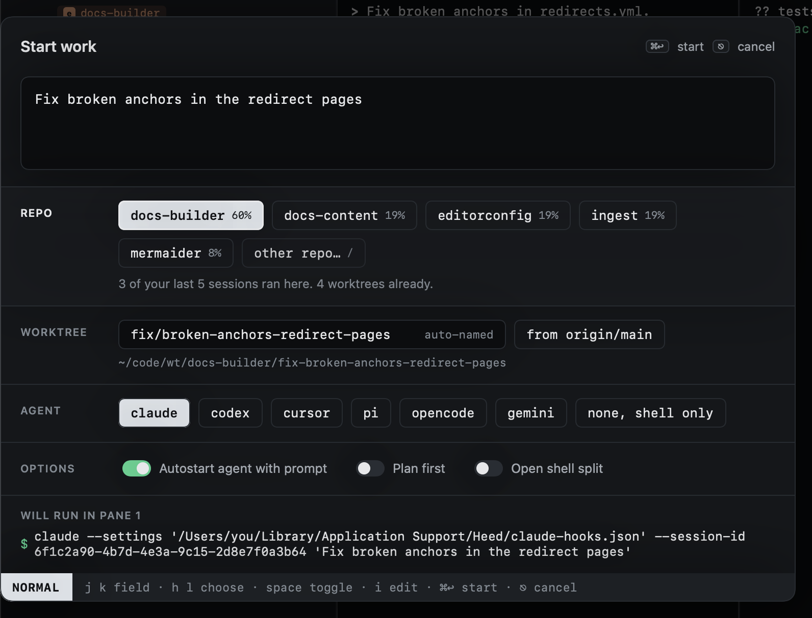
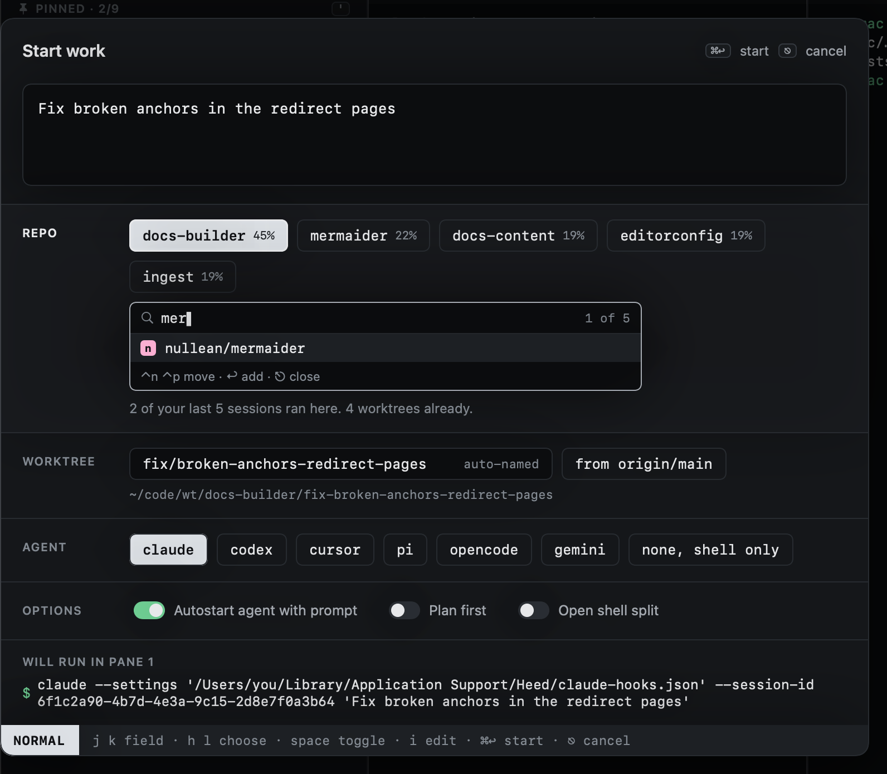

# Choosing repos

As you type, Heed ranks your repos and selects the best guess, only that one: each selected repo gets a worktree, so a
second is always yours to add. Each guess shows how sure it is, and the line under the
chips says why:

- **The prompt names it**: the strongest signal (`… in docs-toolkit`). Whole names only, and not inside a link or
  an `org/repo#12` reference: those point at an issue, not at where the work happens.
- **Words in common** with the repo's name.
- **Where you opened it**: the repos of the session under the cursor (on its host, if it runs on one), or of the
  worktree, PR, issue or history entry. Strong, but a repo the prompt names still wins. Start work from anywhere (the
  global shortcut) has no cursor to go by.
- **How recently you worked there**: the last activity of its sessions, open or closed, counting for half as much
  every two days. Between equal guesses, the more recent repo comes first.



## Smart guesses

On a Mac with Apple Intelligence (macOS 26), Heed also asks Apple's on-device model, once you pause typing for a
moment, which repo the prompt belongs in. It chooses among the ten best guesses above. For each one it sees the repo's
name, the first line of its README and the titles of your last few sessions there. Its pick becomes the first chip and
is selected, and the line under the chips starts with **Fits the prompt:** and the model's reason. Every other chip
stays where it was.

The model is not asked about the repo when the prompt names one, because a named repo always wins, when you opened
Start work from something in a repo (a session, worktree, PR or issue), or once you have picked a repo yourself. The field says **thinking…** while an answer is on its way. Typing never waits for it, and an
answer to a prompt you have since changed is dropped. An answer takes about one to two seconds.

The model runs on this Mac: nothing is sent anywhere. Turn it off in **Settings › Worktrees & cleanup › Start work**,
or in `config.toml`:

```toml
[start_work]
smart_guesses = false
```

Where the model is not available (an older macOS, Apple Intelligence off, or its model still downloading), Start work
guesses by the rules above alone, as it always has.

Move to the repo field (`⎋` then `j`) and use `h` `l` to move between chips and `space` to add or remove one. More than
one repo makes a cross-repo session: a worktree in each, on the same branch. `⌃n` `⌃p` cycle which one is primary.

Repos on your [hosts](../hosts/index.md) are guessed the same way and their chips say `@host`: picking one starts
the work there.

## Any other repo

When none of the guesses is right, the chip **other repo…** opens a search over every repo (or press `/` on the
repo field). Type to narrow, `⌃n` `⌃p` to move, `↩` to add it. It then keeps a chip of its own.

The very last chip, **chat, no repo**, turns the dialog into a [chat](../sessions/chats.md).


