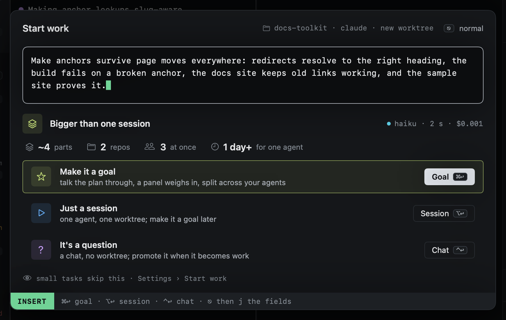

# Bigger than one session

Some prompts are more than one agent in one worktree should take on. While you type a longer prompt (twelve words or
more), Start work sizes it once typing pauses, and again when you press `⌘↩` before it had the chance. When the task
looks bigger than one session, a card takes the place of the fields:



The icons give the rough size: how many parts it splits into, how many repos it touches, how many agents could work on
it at once, and how long one agent would take for all of it. The corner says which model sized it, how long that took
and what it cost.

| Key | |
|---|---|
| `⌘↩` | **Make it a goal**: the goal is made from the prompt and its wizard opens on the first step, the plan |
| `⌥↩` | **Just a session**: the work starts as it would have, with the repo, agent and worktree the header names |
| `⌃↩` | **It's a question**: a [chat](../sessions/chats.md), no worktree; promote it when it becomes work |
| `j` (after `⎋`) or `⇥` | The fields instead of the card, for this prompt; `⌘↩` then starts the session |

The card's options take a click too. Without the card, `⌥↩` adds a line to the prompt as before.

Small tasks never see any of this: a short prompt is not sized, and one that sizes as a session or a chat starts with
`⌘↩` exactly as before. A chat, a promotion and the tutor are never sized.

## How it sizes

First a decision, from the [decider](../configuration/inference.md#decisions) you set up: Apple's on-device model or Hunch where they
answer, a model call behind them. It picks one of chat, session or goal. Only when a goal looks likely does one cheap
model call follow, through [heed's model calls](../configuration/inference.md#model-calls), for the rough size and a title for the goal.
Both count against the daily cap. When decisions are off, or the call fails, Start work starts as it always did.

Turn it off in **Settings › Start work › Size the task**, or in `config.toml`:

```toml
[start_work]
size_check = false
```

A session that turns out bigger than it looked can still [become a goal later](../goals/index.md#from-a-session).
