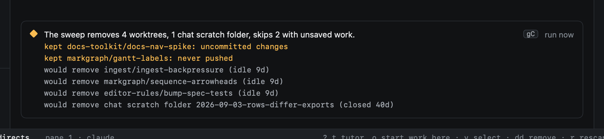
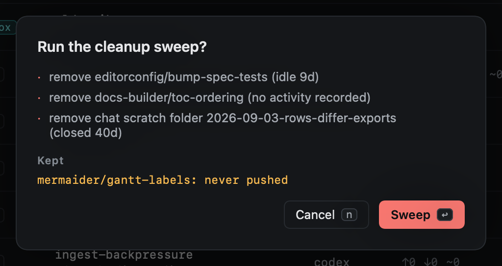

# Cleanup

Cleanup removes worktrees nobody has touched for a while. It is off until you turn it on.

```toml
[cleanup]
enabled = false
idle_days = 14
delete_branch = true        # the local branch; the remote is left alone
ask_before_sweep = false
keep_archive_days = 90      # saved work from removed worktrees; 0 keeps it
```

A worktree is idle when nothing happened in it for `idle_days`: no agent output, keystrokes, hook events, commits or
pull request updates. Dirty, unpushed and pinned work is never removed by a sweep, even though a removal would
[save it first](removing.md#saved-first): a sweep happens without you, so it leaves those to you.


With cleanup on, Repos shows what the next sweep would do. Sweeps run hourly unless `ask_before_sweep` is set; `gC` runs
one now, after a confirmation that lists every worktree it would remove.


## Chats' scratch folders

The sweep also removes the scratch folder of a [chat](../sessions/chats.md) that closed 30 or more days ago. It never
removes the folder of a pinned chat, a folder you picked for a chat, or a chat's folder on a host. The scratch folders are
in the sweep's list with the worktrees, and nothing is removed while cleanup is off. A removed folder is noted in the
chat's History timeline. Reopening the chat makes the folder again, empty.





## Saved work

Every removal saves the worktree as `refs/heed/archive/<branch>` first ([Removing](removing.md#saved-first)). A sweep
also drops the saved work older than `keep_archive_days`, in every repo, and its confirmation lists each one. Set it to 0 to keep them all. With cleanup off, nothing is dropped.

## What runs leave behind

Get it green [runs](../github/watch.md#runs) work in worktrees of their own, on `heed/get-it-green/…` (or
`heed/get-it-merged/…`) branches, and remove both when they end. Anything left over (heed quit mid-run, a removal
failed) is removed by every sweep and at launch, whether or not cleanup is on, as long as it is safe: no uncommitted
changes, and no commits that are not on the pull request's branch. `heed cleanup runs` does the same from a
terminal. Repos and `I` never list these worktrees.
