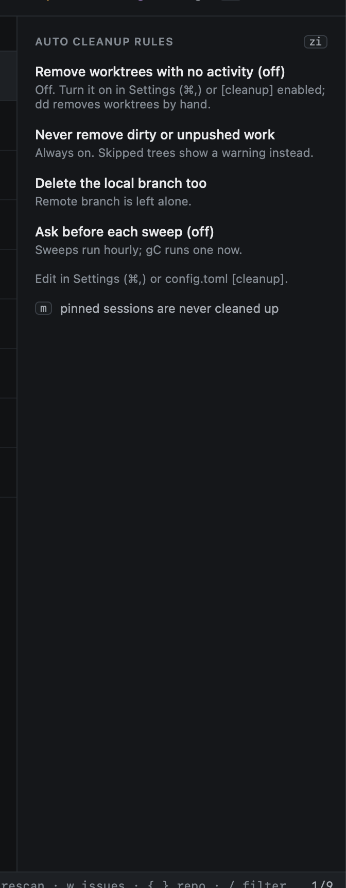
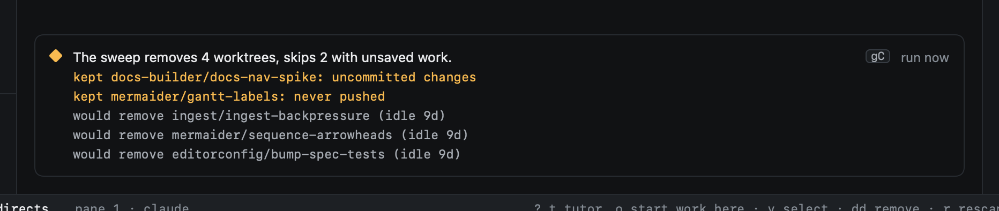

# Cleanup

Cleanup removes worktrees nobody has touched for a while. It is off until you turn it on.

```toml
[cleanup]
enabled = false
idle_days = 14
delete_branch = true        # the local branch; the remote is left alone
ask_before_sweep = false
```

A worktree is idle when nothing happened in it for `idle_days`: no agent output, keystrokes, hook events, commits or
pull request updates. The same safety rules as [removing](removing.md) apply: dirty, unpushed and pinned work is never
removed.



With cleanup on, Repos shows what the next sweep would do. Sweeps run hourly unless `ask_before_sweep` is set; `gC` runs
one now, after a confirmation that lists every worktree it would remove.



## What runs leave behind

Get it green [runs](../github/watch.md#runs) work in worktrees of their own, on `heed/get-it-green/…` (or
`heed/get-it-merged/…`) branches, and remove both when they end. Anything left over (heed quit mid-run, a removal
failed) is removed by every sweep and at launch, whether or not cleanup is on, as long as it is safe: no uncommitted
changes, and no commits that are not on the pull request's branch. `heed cleanup runs` does the same from a
terminal. Repos and `I` never list these worktrees.
