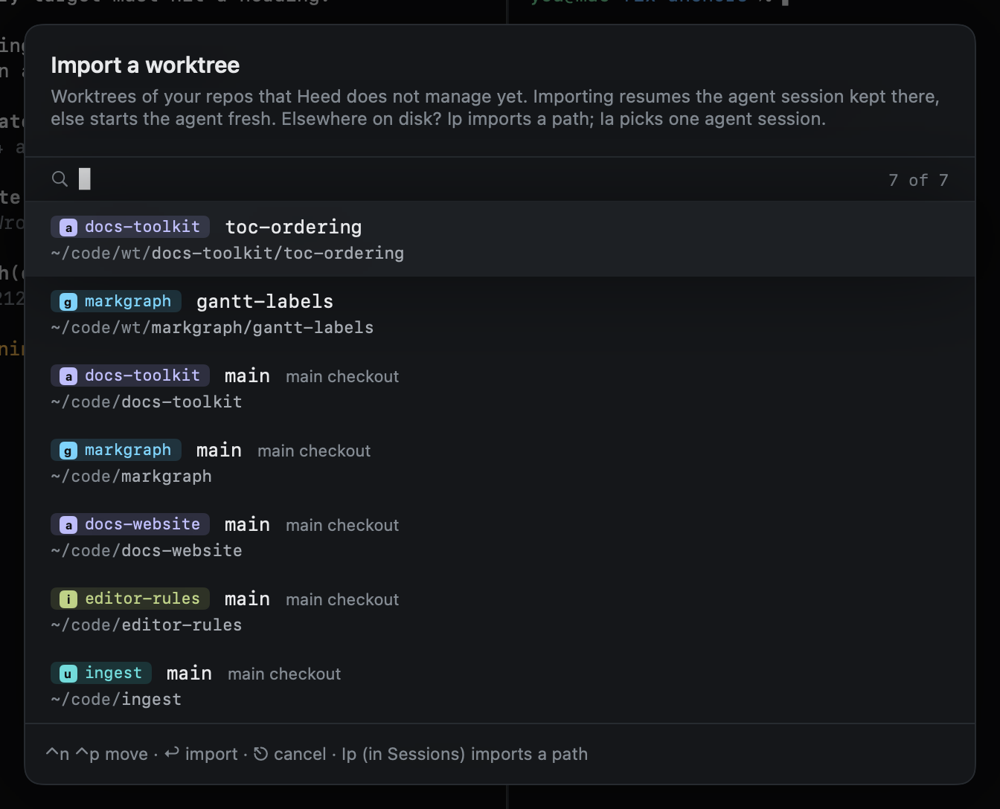
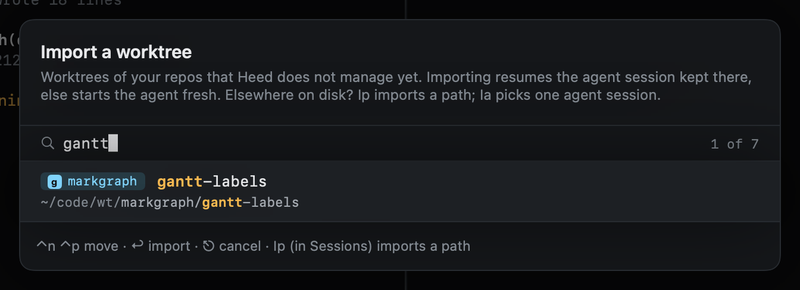
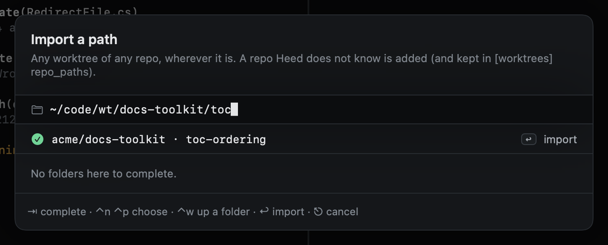
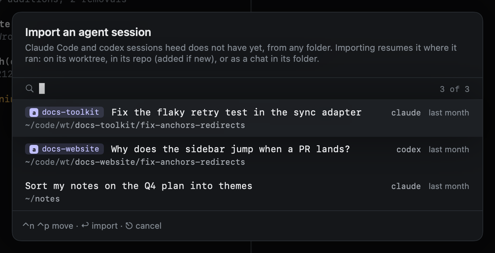

# Importing

Worktrees made outside Heed, where you may have run an agent yourself, can become sessions. Importing one resumes the
newest Claude Code or codex session kept for that folder (its first prompt becomes the title), or starts your default
agent fresh. A confirmation says which before anything starts.

## A worktree Heed knows

`Iw` in Sessions lists the worktrees of your repos that have no session yet, main checkouts last. Type to filter by
repo, branch or the path below its root, `⌃n` `⌃p` to move, `↩` to import. In Repos, `↩` on a row does the same (`v`
and `o` for several).

## Any path

`Ip` in Sessions imports the worktree at a path, whatever repo it belongs to. `⇥` completes folders, `⌃w` goes up one,
and a preview says what is there. A repo Heed did not know is added, and kept in `repo_paths` when it lies outside your
scan roots. `:import <path>` does the same.

## An agent session

`Ia` in Sessions lists the Claude Code and codex sessions on this Mac that Heed does not have yet, newest first, from
any folder: each one's first prompt, its agent, how long ago it ran, and the folder it ran in. Type to filter by
prompt, agent or folder, `⌃n` `⌃p` to move, `↩` to import. Heed resumes the session where it ran, with the agent
that ran it:

- in a worktree Heed knows, it becomes that worktree's session (when the worktree has one already, Heed shows it
  instead);
- in a repo Heed did not know, the repo is added first, as `Ip` does;
- in a folder outside any git repo, it becomes a chat in that folder.

A confirmation says which before anything starts. Sessions already in Heed, ones where nothing was typed, and ones whose
folder is gone are left out. The menu bar's **Import an agent session…** does the same.

## What gets resumed

Heed finds the sessions Claude Code keeps (`~/.claude/projects/<folder>/`) and codex keeps
(`~/.codex/sessions/<yyyy>/<mm>/<dd>/`, by the folder each one says it ran in). Importing a worktree resumes the newest
of them kept for it, with the agent that ran it; `Ia` picks any one. An agent that is not in your config, and the other
agents, start your default agent fresh in the worktree.
