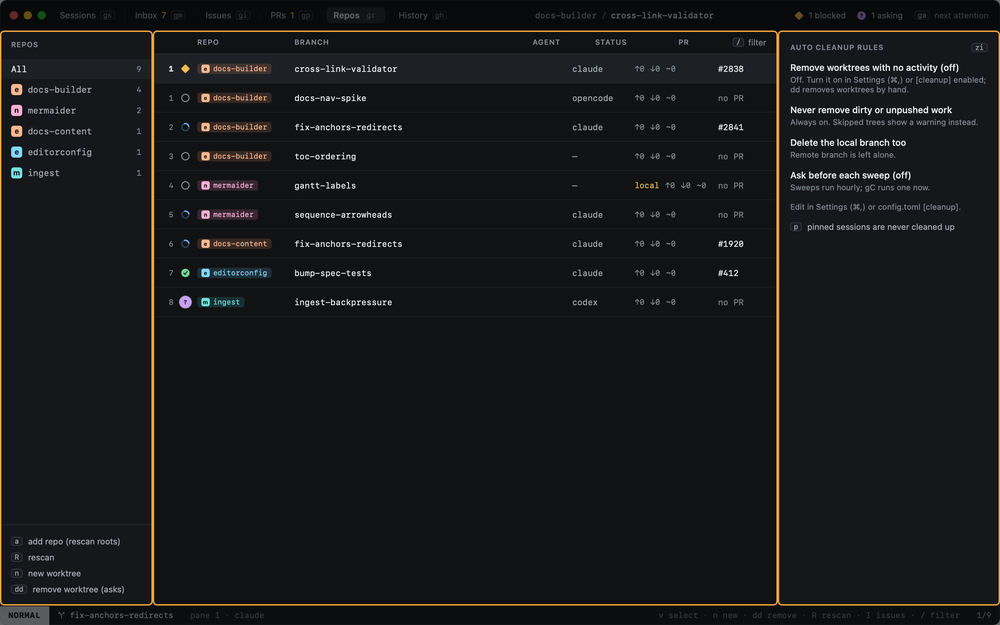

# Worktrees

`gr` opens Repos: every repo Heed knows, every worktree added to them, and the cleanup rules.

The table shows each worktree's repo, branch, the agent of the session working there, its status (upstream, ahead,
behind, uncommitted changes) and its pull request.

| Key | |
|---|---|
| `↩` | Open the worktree's session, or [import](importing.md) it when it has none |
| `n` | New worktree |
| `dd` | [Remove](removing.md) the worktree (asks first) |
| `v` | Select rows, then `d` remove, `y` copy paths, `o` open or import |
| `I` | Flip the repo between all issues and only yours ([Issues](../github/issues.md)) |
| `a` / `R` | Rescan for repos |
| `/` | [Filter](../sessions/filtering.md) by repo, branch or agent |

- [Repos](repos.md): where repos come from, and their order and colours.
- [Importing](importing.md): worktrees made outside Heed, and any path.
- [Removing](removing.md): what is removed, and what never is.
- [Cleanup](cleanup.md): removing idle worktrees automatically.
