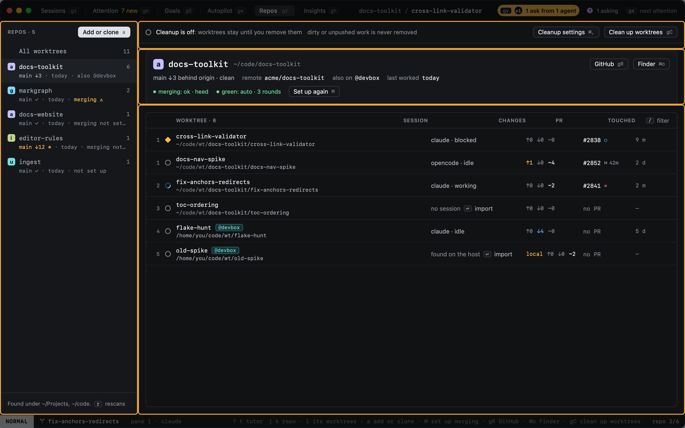
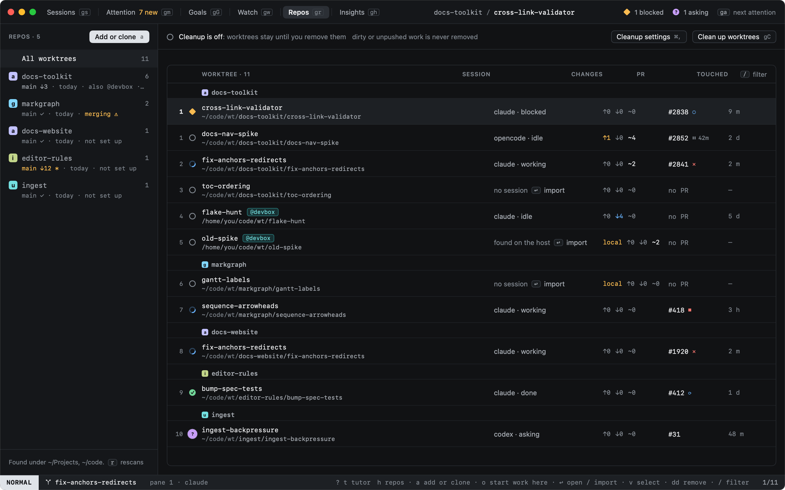
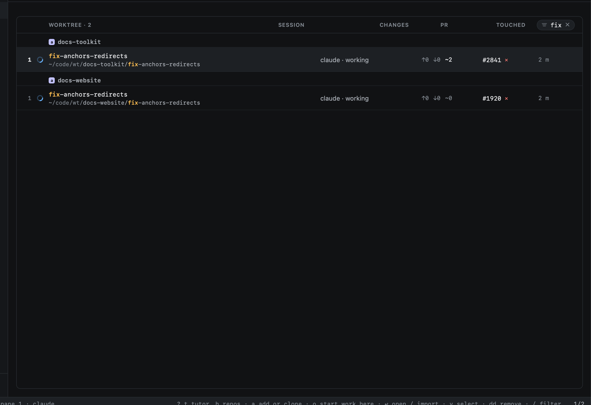

# Worktrees

`gr` opens Repos. On the left, every repo Heed knows; on the right, cleanup up top, the repo you picked, and its
worktrees.

The repo column is a filter. **All worktrees** shows every worktree, grouped by repo; a repo shows only its own, under
a card with the repo's state and actions (see [Repos](repos.md)). `h` moves to the column and `l` back to the table
(`⇥` switches); `j` `k` move within the side you are on, and a click picks a repo or a row.

Each worktree row shows its branch with its path small below (and its host, when it is on one), the session working
there with its agent and state, its changes (ahead, behind, uncommitted files), its pull request, and when you last
touched it. A worktree with no session says so, and `↩` [imports](importing.md) it right there.

| Key | |
|---|---|
| `h` `l` `⇥` | The repo column, the worktree table, or the other one |
| `j` `k` | Pick a repo in the column; move through the worktrees in the table |
| `a` | [Add or clone](repos.md#add-or-clone) a repo |
| `↩` | Open the worktree's session, or [import](importing.md) it when it has none |
| `o` | Start work in the repo under the cursor |
| `dd` | [Remove](removing.md) the worktree (asks first) |
| `v` | Select rows, then `d` remove, `y` copy paths, `o` open or import |
| `M` | [Set up](../github/repo-setup.md) get it merged and get it green for the repo |
| `S` | The repo's detected [setup](setup.md): approve, edit or never |
| `gR` `⌘O` | The repo on GitHub; its folder in Finder |
| `gC` | [Clean up worktrees](cleanup.md) now (asks first) |
| `r` | Refresh: rescan for repos |
| `{` `}` | Previous / next repo in the table |
| `/` | [Filter](../sessions/filtering.md) by repo, branch, path or agent |

A filter matches the part of a path below its root (the worktree root or a repo root from `[worktrees]`, else your home
folder), so `code` does not match every worktree under `~/code`. What matched is marked in the branch and the path.

- [Repos](repos.md): the repo column and card, adding or cloning a repo, where repos come from, their order and
  colours.
- [Setting up](setup.md): setup commands, `.worktreeinclude`, and trusting a repo for agents.
- [Importing](importing.md): worktrees made outside Heed, and any path.
- [Removing](removing.md): what is removed, and what never is.
- [Cleanup](cleanup.md): removing idle worktrees automatically.
