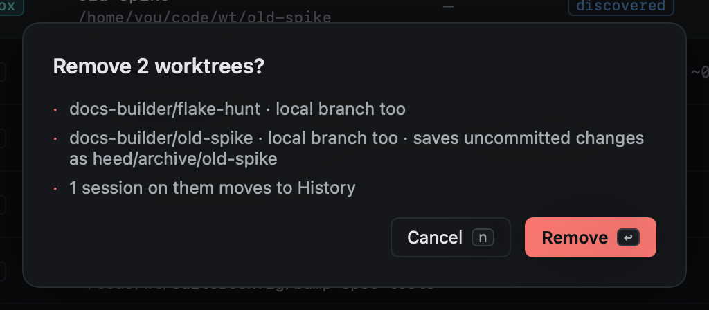

# Removing

`dd` on a worktree in Repos removes it; `v` to select several, then `d`. A confirmation lists what will go, what is
saved first, and what will be kept and why.

Removing a worktree also removes its local branch (`delete_branch` under `[cleanup]`, on by default); the branch on
GitHub is left alone. Sessions working there move to History.

## Saved first

Before a worktree goes, Heed saves it in its repo, so nothing is lost:

- `refs/heed/archive/<branch>` points at the commit it had checked out, unpushed commits and all.
- `refs/heed/archive/<branch>-wip` holds its **uncommitted changes**, untracked files included (ignored ones are not),
  as a commit on top of that.

The confirmation says what will be saved, and the message after it says what was: "saved 3 unpushed commits as
heed/archive/old-spike". The refs are ordinary git refs in the repo's main checkout: `git log heed/archive/old-spike`,
`git diff heed/archive/old-spike heed/archive/old-spike-wip`, or `git branch old-spike heed/archive/old-spike` to
bring a branch back by hand. Removing the same branch again replaces them.

[Reopening](../history/reopening.md) the session uses them when the branch is gone. [Cleanup](cleanup.md) drops them
after `keep_archive_days` (90 by default).

## Never removed

- A worktree used by a **pinned** session.

[Cleanup](cleanup.md) is stricter: it never removes a worktree with uncommitted changes, unpushed commits, a branch that
was never pushed, or an unknown status. [Deleting a session](../sessions/pin-park-close-delete.md) removes and saves the
same way as `dd` here.
