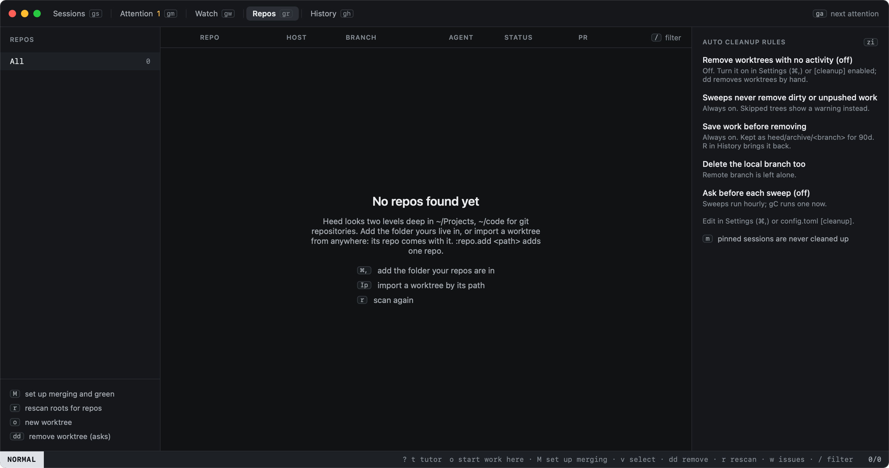
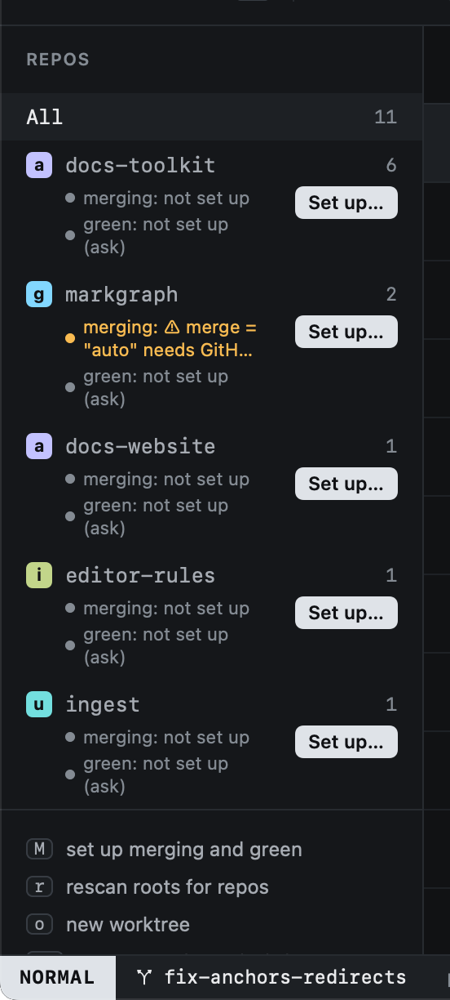

# Repos

Heed scans `repo_roots` (two levels deep) for git repositories, and lists every worktree added to them.

```toml
[worktrees]
repo_roots = ["~/Projects", "~/code"]
repo_paths = []          # repos outside the roots, added when you import one of their worktrees by path
```

When it finds none, Repos says where it looked and offers the next step: add the folder your repos are in (Settings ›
Worktrees & cleanup), import a worktree by its path (its repo comes with it, into `repo_paths`), or scan again.
`:repo.add <path>` adds a single repo.





- **Merging and green.** Under each repo on GitHub, where get it merged and get it green stand, and **Set up…**,
  which proposes them from the repo's history (`M`, see [Setting up a repo](../github/repo-setup.md)).
- **Order.** Repos with the most worktrees come first, then by name; the worktree table groups rows in the same
  order, and Start work ranks those repos higher too.
- **Colours.** Every org has a colour, and its repos inherit it. Set them in Settings (`⌘,`) or in `config.toml`:

```toml
[orgs.acme]
color = "teal"      # teal, pink, lime, orange, periwinkle, sky

[repos."acme/docs-toolkit"]
color = "orange"
```

Org avatars are fetched once and cached; repos without a GitHub remote get a letter tile.
