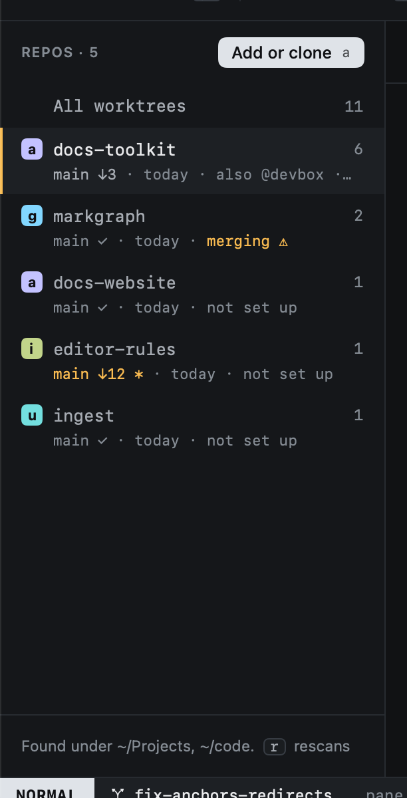
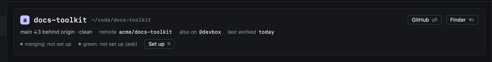
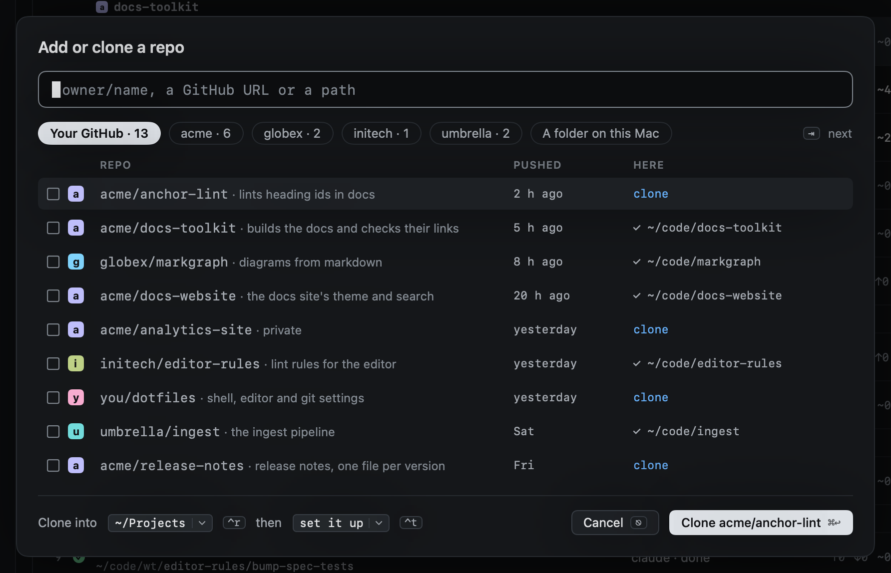
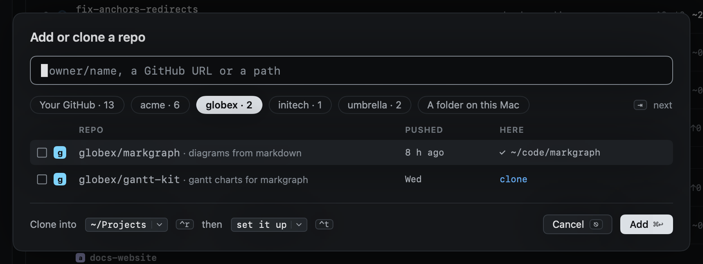
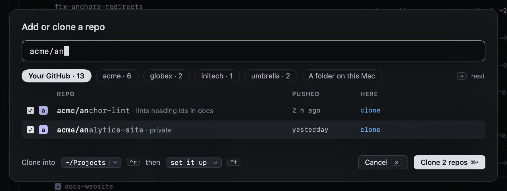
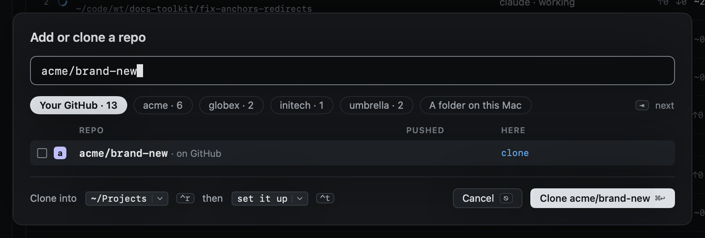
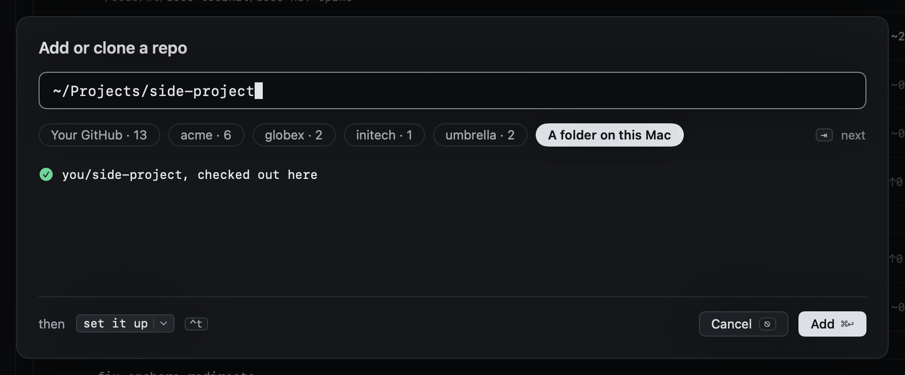
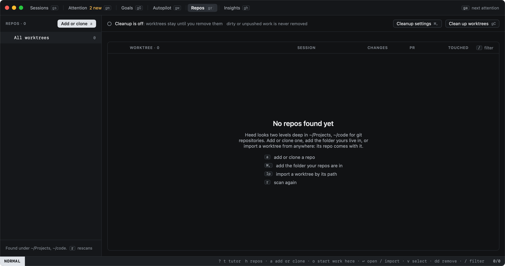

# Repos

## The repo column

Each repo in the column has its org's tile, its name, how many worktrees it has, and one line on how it stands:



- **main against origin**: `main ✓` when the main checkout is level with its upstream and clean, `main ↓3` when it is
  three commits behind, `↑` for commits ahead and `*` for uncommitted changes. This is what the last scan read, as of
  your last `git fetch` there: Heed does not fetch for it. A repo without a GitHub remote says **no remote**.
- **When you last worked there**: today, yesterday, a weekday, then weeks.
- **also @host**: the [hosts](../hosts/index.md) that have the repo too.
- **What setup lacks**: **not set up** while get it merged and get it green are both undecided, **merging not set
  up** or **green not set up** for one, **merging ⚠** when its setting does not work on GitHub. Nothing once both
  are decided.

Picking a repo (a click, or `h` then `j` `k`) narrows the worktrees to it and shows its card:



The card has the repo's path, main against origin at length (`main ↓3 behind origin · clean`), its remote, the hosts it
is also on, when you last worked there, and where get it merged and get it green stand, with **Set up** (`M`, see
[Setting up a repo](../github/repo-setup.md)). Its buttons open the repo on GitHub (`gR`) and its folder in Finder
(`⌘O`).

## Add or clone

`a` in Repos, the **Add or clone** button at the top of the column, or `:repo.add` opens one dialog for every way a
repo gets here:



- **The field** takes `owner/name`, a GitHub URL or a path. Words narrow the lists below, on the repo's name or its
  description. An `owner/name` or URL no list has is looked up with a read-only `gh repo view`, as Start work's
  [repo search](../start-work/repos.md#a-repo-heed-does-not-know) does. A path switches to the folder tab.
- **The tabs**: **Your GitHub** is your repos and every org's together, then a tab per org, then **A folder on this
  Mac**. The lists come from `gh repo list` (read only), newest push first; Heed keeps the last answer and asks again
  when the dialog opens, at most every 15 minutes, off the main thread. `⇥` and `⇧⇥` move between tabs.
- **Here** says where each repo already is: its folder on this Mac, **@host only** (it is on a host, not here), or
  **clone**. Archived repos are dimmed.
- `⌃n` `⌃p` (or `↓` `↑`) move, and `space` picks several.





The footer picks the root to clone into (one of `repo_roots`, `⌃r` cycles them) and what happens after (`⌃t`). `⌘↩`
(or `↩`) clones each picked repo that is not on this Mac with `gh repo clone` into the root, adds the ones that are, then
picks the first in the column and does the **then**:

- **set it up** (the default): [Repo setup](../github/repo-setup.md) for get it merged and get it green.
- **start work**: Start work, with the repo picked.
- **just add it**: nothing more.

The default is a setting, **Settings › Worktrees › After adding a repo**, or in `config.toml`:

```toml
[worktrees]
after_add = "setup"      # setup | start_work | add
```

A repo no list has, typed as `owner/name`, clones the same way once GitHub has answered:



On the folder tab, the field completes folders with `⇥` (`⌃w` goes up one), and says whether a git checkout is there.
`⌘↩` adds it in place; a folder outside `repo_roots` is kept in `repo_paths`.



`:repo.add <path>` adds the repo at a path without the dialog.

## Where repos come from

Heed scans `repo_roots` (two levels deep) for git repositories, and lists every worktree added to them.

```toml
[worktrees]
repo_roots = ["~/Projects", "~/code"]
repo_paths = []          # repos outside the roots, added by path
```

When it finds none, Repos says where it looked and offers the next step: add or clone a repo, add the folder your repos
are in (Settings › Worktrees), import a worktree by its path (its repo comes with it, into `repo_paths`), or scan again.



## Order and colours

- **Order.** Repos with the most worktrees come first, then by name; All groups the worktrees in the same order, and
  Start work ranks those repos higher too.
- **Colours.** Every org has a colour, and its repos inherit it. Set them in Settings (`⌘,`) or in `config.toml`:

```toml
[orgs.acme]
color = "teal"      # teal, pink, lime, orange, periwinkle, sky

[repos."acme/docs-toolkit"]
color = "orange"
```

Org avatars are fetched once and cached; repos without a GitHub remote get a letter tile.
