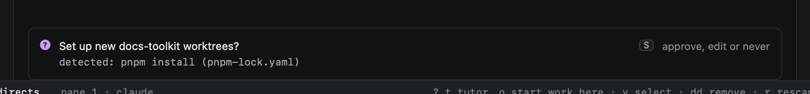
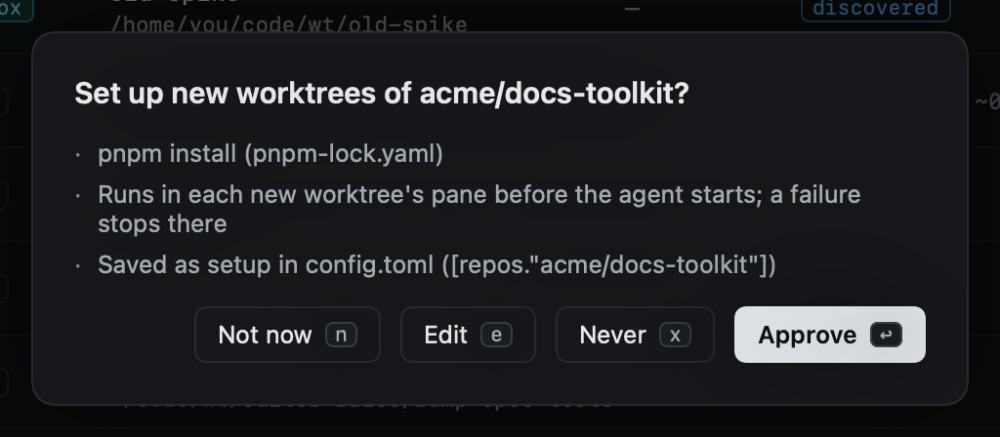

# Setting up new worktrees

A fresh worktree has the repo's tracked files and nothing else: no `node_modules`, no `.env`, no tools installed. Heed
sets every worktree it makes up the same way, for sessions from Start work and for get it green's
[background runs](../github/watch.md#runs) alike.

## Setup commands

Setup is a list of commands a new worktree runs in its pane before the agent starts. The agent starts only when every one
of them passed; a failure says what failed and which agent to run again, and leaves the pane at your shell:

```text
heed: setup failed (pnpm install); fix it, then run the agent again: claude
```

Setup commands are sh: they run under `sh -c` whatever your login shell is, and the agent then starts in your own
shell, in its syntax.

A background run whose setup fails ends as failed, with that reason, instead of an agent working in a broken tree.

Heed proposes setup from what it finds in the repo's main checkout, and runs nothing until you approve it:

- **mise.** A repo with `mise.toml` (or `.mise.toml`, `.config/mise.toml`, `.config/mise/config.toml`) gets
  `mise install` alone: it installs the repo's tools and runs its `postinstall` hooks, which install the rest.
- **Lockfiles**, otherwise: `pnpm-lock.yaml` → `pnpm install`, `bun.lock` → `bun install`, `package-lock.json` →
  `npm ci`, `yarn.lock` → `yarn install`, `uv.lock` → `uv sync`, `poetry.lock` → `poetry install`, a `.sln` or
  `.csproj` → `dotnet restore`. Cargo and Go fetch when they build, so they get nothing. One install at the root covers a
  workspace.

Git hooks need nothing of their own: they live in the repo's shared git directory, and husky's per-worktree setup runs
from the package install's `prepare`.

In Repos (`gr`), a repo with a proposal waiting shows it under the table. `S` (`:setup.review`) asks: `y` approves it,
`e` edits it in Settings, `x` never runs any setup there and stops the proposal.





Approving writes the commands to `config.toml`; never writes an empty list. Set them by hand there, or in Settings ›
Orgs & repos, per repo or for a whole org:

```toml
[repos."acme/docs-toolkit"]
setup = ["pnpm install", "pnpm build:icons"]

[orgs.acme]
setup = []          # no setup, and no proposals, for the org's repos that do not set their own
```

| Command | |
|---|---|
| `:setup.review` | The repo's detected setup: approve, edit or never (`S` in Repos) |
| `:setup.approve` | Approve the detected setup |
| `:setup.never` | No setup for the repo, and no more proposals |
| `:setup.edit` | Settings › Orgs & repos, on the repo |

## Files from the main checkout

A `.worktreeinclude` file at the root of the main checkout names files to copy into each new worktree, in `.gitignore`
syntax. Only files that git ignores are copied, never tracked ones, and a file the worktree already has is left alone:

```text
.env
.env.local
config/*.secret.json
```

The same file other tools that make worktrees read. It works on [hosts](../hosts/index.md) too, from the host's checkout.

## Trusting a repo for agents

Claude Code asks whether you trust a folder the first time it starts in one, and it asks for the repository's main
checkout, which every worktree of it shares. The first time heed starts Claude in a repo of this Mac that is not
trusted yet, it offers once to trust it ahead of time: yes sets `hasTrustDialogAccepted` for the main checkout in
`~/.claude.json`, as Claude's documentation describes, changing nothing else in the file (heed keeps a copy of it the
first time, as `~/.claude.json.heed-backup`). Your home folder is never trusted this way.

A repo whose mise config sets `[env]` is not loaded until mise trusts it; the same offer, for any agent, runs
`mise trust` for its main checkout, which covers its worktrees too.

```toml
[worktrees]
offer_trust = true      # false: never offer
```
